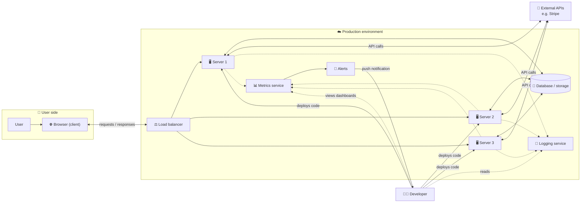
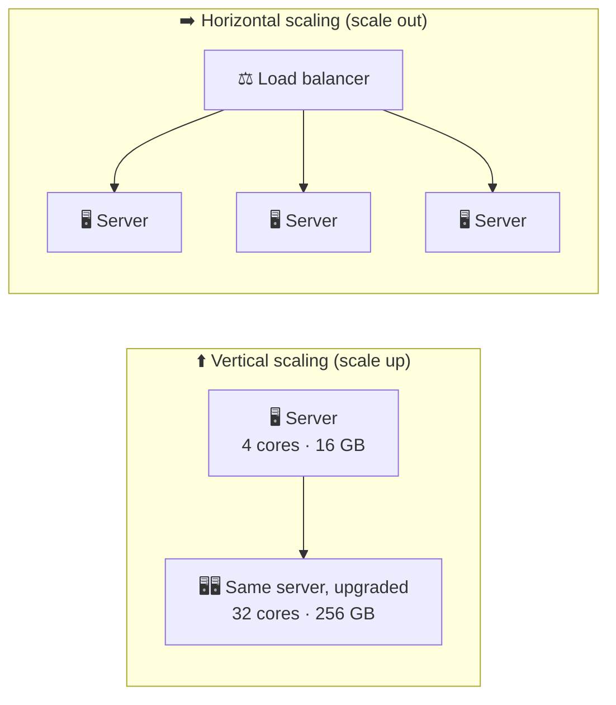
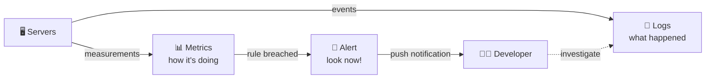

# 🏛️ Application Architecture

> [!abstract] One-line summary
> A production app is more than code on a server: users reach **many servers through a load balancer**, servers talk to **storage and external APIs**, and developers watch it all through **logs, metrics, and alerts**.

## 1. TL;DR

- 🖥️ **Server**: a computer that handles requests from other computers. Developers deploy code to it.
- 💾 **Storage**: app data usually lives in an **external** database or cloud storage, reached over the network, so every server can share it and it survives a server failure.
- 🌐 **Client**: the user's side, usually a web browser that sends requests and renders the HTML/CSS/JavaScript it gets back.
- 📈 **Scaling**: **vertical** = a bigger machine; **horizontal** = more machines behind a **load balancer**.
- 🔌 **External APIs**: servers call other services, such as Stripe for payments.
- 🔍 **Observability**: **logs** say *what happened*, **metrics** say *how the system is doing*, **alerts** tell you *when to look*.

## 2. The Big Picture

> [!tip] Reading the diagram
> **Users** only ever talk to the front door (the load balancer). **Developers** deploy code to the servers and look at logs, metrics, and alerts. Everything is connected over a **network**.

## 3. Two Perspectives

### 3.1 🧑‍💻 The developer's view

1. Developers write code and **deploy** it to a **server**.
2. The server needs **persistent storage** for the app's data.
3. Data kept only on one server's own disk can't be shared with other servers and is lost if that server fails, so servers usually talk to **external storage** (a database or cloud storage) over the network.

> [!note] "Server" in one line
> For now: a server is a computer that **handles requests from another computer**. (Strictly, "server" can also mean the program doing the handling.)

### 3.2 👤 The user's view

1. A user makes a request, usually through a **web browser**. The browser is the **client**.
2. The server responds. For a front-end feature, it sends the **HTML, CSS, and JavaScript** the browser needs to show the page.
3. With many users, one server becomes a **bottleneck**, usually its **CPU**, **RAM**, disk, or network (see [[Computer Architecture]]). To keep it fast, we must **scale**.

## 4. 📈 Scaling the Server

| | ⬆️ Vertical scaling | ➡️ Horizontal scaling |
| --- | --- | --- |
| What you do | Upgrade one machine: more RAM, more cores, faster CPU | Add more machines running the same code |
| Limit | Hard ceiling: every machine maxes out eventually | Practically unlimited: keep adding servers |
| Hardware | Expensive high-end machines | Cheap **commodity hardware** (standard, inexpensive) |
| If a server dies | The whole app is down if this is your only server (single point of failure) | Traffic moves to the remaining servers |
| Engineering effort | Low: the code doesn't change | High: needs a load balancer, and servers must coordinate |
| Best for | Simple apps, early stages | Large systems with lots of traffic |

> [!important] Rule of thumb
> Large systems prefer **horizontal** scaling: it's more powerful and more fault-tolerant. But **vertical** scaling is often enough for simple apps, and much easier.

> [!example] Real-world example: Amazon Prime Video (2023)
> One Prime Video monitoring service moved from a distributed **serverless/microservices** design to a single **monolith** and cut its infrastructure cost by about 90%. The monolith still ran on cloud infrastructure and could still be scaled out; what changed was removing costly network calls and data transfers between many small components. More distribution isn't automatically better; it's a trade-off.

### 4.1 ⚖️ Load balancer

With many servers, something has to decide **which server gets which request**. That's the **load balancer**: it spreads incoming requests across a group of servers.

- It keeps any one server from being overloaded.
- It stops sending traffic to a server that goes down.
- Common strategies: **round robin** (take turns), **least connections** (send to the least busy server).
- The load balancer could itself become a single point of failure, so production setups usually run more than one.

> [!warning] A catch with horizontal scaling
> Any request can land on any server, so servers should be **stateless**: keep shared data such as sessions in the database or a shared cache, not in one server's memory.

### 4.2 🔌 External APIs

Servers don't live in isolation. They often call **other companies' services** through APIs. For example, [neetcode.io](https://neetcode.io) uses **Stripe** for payments. To the external service, your server is the client.

## 5. 🔍 Logging, Metrics, and Alerts

| | 📜 Logs | 📊 Metrics | 🚨 Alerts |
| --- | --- | --- | --- |
| Answers | *What happened?* | *How is the system doing?* | *Do I need to look right now?* |
| Contents | Records of individual events: requests, errors, what happened before a crash | Numbers over time: CPU usage, RAM usage, network traffic, success rate | A rule that fires a notification, usually on a metric, e.g. "success rate < 95%" |
| Where | Written to the server itself, or (more reliably) to an **external** logging server | Collected from many sources across the environment | Sent as a push notification to developers |
| Good for | Debugging a specific failure | Spotting bottlenecks and trends | Not having to watch dashboards all day |

> [!tip] Why logs go to an external server
> If the server crashes or its disk dies, logs stored on it may be lost, exactly when you need them most.

**Alerts in practice:** checking metrics by hand is like checking your phone every 5 minutes for a message. Instead, set a rule and get a **push notification**. For example: normally 100% of requests succeed, so alert when the success rate drops **below 95%**.

## 6. 🌐 What's Next

All these parts may run on **different computers**, so they talk over a **network**. That raises the next questions in the course:

- How do the components communicate?
- Which **protocols** do they follow?
- How can those protocols be optimized?

## 7. ⚠️ Clarifications to the Lesson Text

- **"A load balancer will *evenly* distribute requests."** It *spreads* requests by a strategy, and "even" depends on what you measure. Round robin gives each server a roughly equal number of requests. Least connections favors whichever server is least busy right now. Weighted strategies deliberately send more traffic to bigger servers.
- **"Amazon Prime Video migrated from microservices to a monolith."** It was **one monitoring service** (in 2023), not Prime Video as a whole, and it moved away from a serverless, distributed design. The lesson is "pick the simplest architecture that works", not "monoliths beat microservices".
- **Horizontal scaling isn't free.** The lesson mentions the extra engineering effort. The biggest part is usually making servers **stateless** and keeping data consistent across them.

## 8. 🧩 Review Questions

**Q1. What is the difference between vertical and horizontal scaling?**

> [!success]- Answer
> Vertical scaling upgrades a single machine (more RAM, more or faster CPU cores). Horizontal scaling adds more machines running the same code, with a load balancer spreading requests across them.

**Q2. Why do large systems usually prefer horizontal scaling?**

> [!success]- Answer
> It has practically no ceiling (just keep adding servers), uses cheap commodity hardware, and survives a server failure because traffic moves to the other servers. The trade-off is more engineering effort.

**Q3. When might vertical scaling be the better choice?**

> [!success]- Answer
> For simple or early-stage apps: it needs no code changes and no coordination between servers, and it is often enough.

**Q4. What does a load balancer do?**

> [!success]- Answer
> It decides which server handles each incoming request, spreading load across a group of servers and skipping servers that are down.

**Q5. What is the difference between logs and metrics?**

> [!success]- Answer
> Logs record individual events (what happened, errors, what led up to a crash). Metrics are numbers over time (CPU, RAM, network, success rate) that show how the system is doing and where the bottlenecks are.

**Q6. Why write logs to an external server?**

> [!success]- Answer
> If the server crashes or its disk fails, logs stored on it could be lost. An external log server keeps them available for debugging.

**Q7. Why use alerts instead of watching metrics?**

> [!success]- Answer
> Nobody can watch dashboards all day. An alert is a rule on a metric, such as "success rate below 95%", that sends a push notification only when something needs attention.

**Q8. Why should servers be stateless when scaling horizontally?**

> [!success]- Answer
> The load balancer can send each request to any server. If session data lived in one server's memory, the next request might hit a server that doesn't have it. Shared state belongs in a database or shared cache.

## 9. 🔗 Related

- ⬅️ Previous: [[Computer Architecture]]
- [[📌 系统设计总览]]
- ➡️ Next: [[Design Requirements]]
- Coming up: networking and protocols
