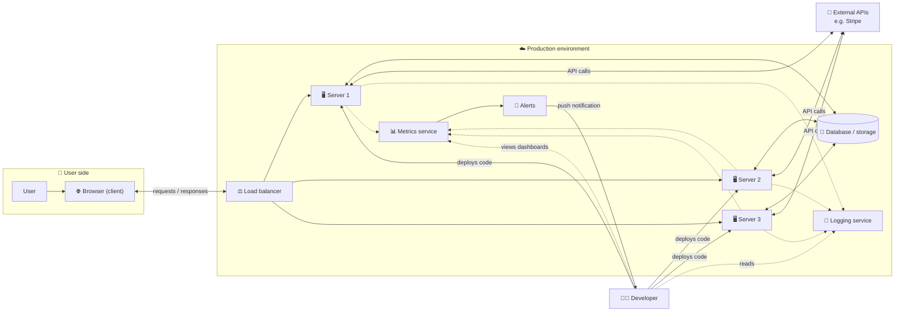

# 🏛️ Application Architecture

> [!abstract] 一句话总结 One-line summary
> 生产环境的应用不只是服务器上的代码：用户通过**负载均衡器访问多台服务器**，服务器与**存储和外部 API** 通信，开发者通过**日志、指标和告警**观察这一切。
> A production app is more than code on a server: users reach **many servers through a load balancer**, servers talk to **storage and external APIs**, and developers watch it all through **logs, metrics, and alerts**.

## 1. 太长不看 TL;DR

- 🖥️ **服务器 Server:** 处理其他计算机请求的计算机。开发者把代码部署到它上面。
  A computer that handles requests from other computers. Developers deploy code to it.
- 💾 **存储 Storage:** 应用数据通常放在**外部**数据库或云存储里，通过网络访问，这样所有服务器都能共享，某台服务器挂了数据也还在。
  App data usually lives in an **external** database or cloud storage, reached over the network, so every server can share it and it survives a server failure.
- 🌐 **客户端 Client:** 用户这一侧，通常是浏览器：发送请求，并渲染返回的 HTML/CSS/JavaScript 页面。用户多了，一台服务器的 CPU、内存、磁盘或网络就会成为**瓶颈**（见 [[Computer Architecture|计算机架构 Computer Architecture]]）。
  The user's side, usually a web browser that sends requests and renders the HTML/CSS/JavaScript it gets back. With many users, one server's CPU, RAM, disk, or network becomes a **bottleneck** (see [[Computer Architecture|计算机架构 Computer Architecture]]).
- 📈 **扩展 Scaling:** **垂直** = 换一台更大的机器；**水平** = 在**负载均衡器**后面加更多机器。
  **Vertical** = a bigger machine; **horizontal** = more machines behind a **load balancer**.
- 🔌 **外部 API External APIs:** 服务器会调用其他服务，比如用 Stripe 处理支付。对外部服务来说，你的服务器就是客户端。
  Servers call other services, such as Stripe for payments. To the external service, your server is the client.
- 🔍 **可观测性 Observability:** **日志**告诉你*发生了什么*，**指标**告诉你*系统状态如何*，**告警**告诉你*什么时候该看*。
  **Logs** say *what happened*, **metrics** say *how the system is doing*, **alerts** tell you *when to look*.

## 2. 全局视图 The Big Picture

## 3. 📈 扩展服务器 Scaling the Server

| | ⬆️ 垂直扩展 Vertical scaling | ➡️ 水平扩展 Horizontal scaling |
| --- | --- | --- |
| 做法 What you do | 升级一台机器：更多内存、更多核、更快的 CPU 处理器 Upgrade one machine: more RAM, more cores, faster CPU | 增加运行相同代码的机器 Add more machines running the same code |
| 上限 Limit | 有硬上限：任何机器最终都会到顶 Hard ceiling: every machine maxes out eventually | 上限高得多：继续加服务器（但数据库等共享部分可能成为新瓶颈） Much higher: keep adding servers (though shared parts like the database can become the new bottleneck) |
| 硬件 Hardware | 昂贵的高端机器 Expensive high-end machines | 便宜的**通用硬件**（标准、廉价） Cheap **commodity hardware** (standard, inexpensive) |
| 服务器挂了 If a server dies | 如果这是唯一的服务器，整个应用就挂了（单点故障） The whole app is down if this is your only server (single point of failure) | 流量转到其余服务器 Traffic moves to the remaining servers |
| 工程成本 Engineering effort | 低：代码不用改 Low: the code doesn't change | 高：需要负载均衡器，服务器要**无状态**并保持数据一致 High: needs a load balancer, and servers must be **stateless** and keep data consistent |
| 适合 Best for | 简单应用、早期阶段 Simple apps, early stages | 流量很大的大型系统 Large systems with lots of traffic |

> [!important] 经验法则 Rule of thumb
> 大型系统更倾向**水平**扩展：能力更强，容错也更好。但对简单应用来说，**垂直**扩展往往就够了，而且简单得多。选**能用的最简单架构**。
> Large systems prefer **horizontal** scaling: it's more powerful and more fault-tolerant. But **vertical** scaling is often enough for simple apps, and much easier. Pick the **simplest architecture that works**.

> [!example] 真实案例：Prime Video（2023） Real-world example: Amazon Prime Video (2023)
> Prime Video 的**一个监控服务**（不是整个 Prime Video）从分布式的 serverless 设计改回了**单体应用**，基础设施成本降低了约 90%。单体仍可水平扩展；省下的是小组件之间昂贵的网络调用和数据传输。教训是“选最简单的”，而不是“单体胜过微服务”。
> **One Prime Video monitoring service** (not Prime Video as a whole) moved from a distributed serverless design to a **monolith** and cut its infrastructure cost by about 90%. The monolith could still scale out; the savings came from dropping costly network calls and data transfers between small components. The lesson is "pick the simplest", not "monoliths beat microservices".

### 3.1 ⚖️ 负载均衡器 Load balancer

有很多台服务器时，**负载均衡器**决定**哪个请求交给哪台服务器**，把进来的请求分散到一组服务器上。
With many servers, the **load balancer** decides **which server gets which request** and spreads incoming requests across the group.

- 它防止任何一台服务器过载，并且不再把流量发给挂掉的服务器（靠健康检查）。
  It keeps any one server from being overloaded and stops sending traffic to servers that are down (via health checks).
- 常见策略：**轮询**（轮流分配）、**最少连接**（发给最闲的服务器）、**加权**（故意给更大的服务器更多流量）。“均匀”取决于你衡量什么。
  Common strategies: **round robin** (take turns), **least connections** (send to the least busy server), **weighted** (deliberately send more traffic to bigger servers). "Even" depends on what you measure.
- 负载均衡器本身也可能成为单点故障，所以生产环境通常会部署不止一个。
  The load balancer could itself become a single point of failure, so production setups usually run more than one.

> [!warning] 水平扩展的一个坑 A catch with horizontal scaling
> 任何请求都可能落到任何一台服务器上，所以服务器应该是**无状态的**：会话这类共享数据要放在数据库或共享缓存里，而不是某台服务器的内存里。
> Any request can land on any server, so servers should be **stateless**: keep shared data such as sessions in the database or a shared cache, not in one server's memory.

## 4. 🔍 日志、指标和告警 Logging, Metrics, and Alerts

| | 📜 日志 Logs | 📊 指标 Metrics | 🚨 告警 Alerts |
| --- | --- | --- | --- |
| 回答的问题 Answers | 发生了什么？ What happened? | 系统状态如何？ How is the system doing? | 我现在需要看吗？ Do I need to look right now? |
| 内容 Contents | 单个事件的记录：请求、错误、崩溃前发生了什么 Records of individual events: requests, errors, what happened before a crash | 随时间变化的数值：CPU、内存、网络流量、成功率 Numbers over time: CPU usage, RAM usage, network traffic, success rate | 一条触发通知的规则，通常基于指标，例如“成功率低于 95%” A rule that fires a notification, usually on a metric, e.g. "success rate < 95%" |
| 存在哪 Where | 最好写到**外部**日志服务：服务器崩溃或磁盘损坏时，本地日志可能正好丢失 Best sent to an **external** logging service: if the server crashes or its disk dies, local logs may be lost exactly when you need them | 从整个环境的多个来源收集 Collected from many sources across the environment | 以推送通知发给开发者 Sent as a push notification to developers |
| 适合 Good for | 排查某一次具体故障 Debugging a specific failure | 发现瓶颈和趋势 Spotting bottlenecks and trends | 不用整天盯着仪表盘 Not having to watch dashboards all day |

## 5. ⚠️ 对课程原文的澄清 Clarifications to the Lesson Text

- **“负载均衡器会*均匀*分配请求” "A load balancer will *evenly* distribute requests":** 它按某种策略*分散*请求；轮询让请求数大致相同，最少连接按当前负载分配，加权策略则有意不均匀（见 3.1）。
  It *spreads* requests by a strategy; round robin gives each server roughly equal request counts, least connections follows current load, and weighted strategies are deliberately uneven (see 3.1).
- **“Prime Video 从微服务迁移到了单体” "Amazon Prime Video migrated from microservices to a monolith":** 只是**一个监控服务**，而且是从 serverless 设计迁出的（见第 3 节）。
  It was **one monitoring service**, and it moved away from a serverless design (see section 3).

## 6. 🧩 复习题 Review Questions

**Q1.** 垂直扩展和水平扩展有什么区别？ What is the difference between vertical and horizontal scaling?

> [!success]- 答案 Answer
> 垂直扩展是升级单台机器（更多内存、更多或更快的 CPU 核）。水平扩展是增加运行相同代码的机器，并用负载均衡器把请求分散到这些机器上。
> Vertical scaling upgrades a single machine (more RAM, more or faster CPU cores). Horizontal scaling adds more machines running the same code, with a load balancer spreading requests across them.

**Q2.** 为什么大型系统通常更倾向水平扩展？ Why do large systems usually prefer horizontal scaling?

> [!success]- 答案 Answer
> 上限高得多（继续加服务器），用便宜的通用硬件，而且某台服务器挂了流量会转到其他服务器。代价是更多的工程成本。简单或早期的应用则往往垂直扩展就够了。
> Its ceiling is much higher (keep adding servers), it uses cheap commodity hardware, and it survives a server failure because traffic moves to the others. The trade-off is more engineering effort; simple or early-stage apps are often fine scaling vertically.

**Q3.** 日志和指标有什么区别？为什么还要告警？ What is the difference between logs and metrics, and why add alerts?

> [!success]- 答案 Answer
> 日志记录单个事件（发生了什么、错误、崩溃前的经过）；指标是随时间变化的数值（CPU、内存、成功率），显示系统状态和瓶颈。没人能整天盯着仪表盘，所以告警在指标越过规则（如“成功率低于 95%”）时发推送通知。
> Logs record individual events (what happened, errors, what led up to a crash); metrics are numbers over time (CPU, RAM, success rate) that show how the system is doing and where the bottlenecks are. Nobody can watch dashboards all day, so an alert sends a push notification when a metric breaks a rule (e.g. "success rate below 95%").

**Q4.** 水平扩展时，为什么服务器应该是无状态的？ Why should servers be stateless when scaling horizontally?

> [!success]- 答案 Answer
> 负载均衡器可能把每个请求发给任何一台服务器。如果会话数据存在某台服务器的内存里，下一个请求可能落到没有这份数据的服务器上。共享状态应该放在数据库或共享缓存里。
> The load balancer can send each request to any server. If session data lived in one server's memory, the next request might hit a server that doesn't have it. Shared state belongs in a database or shared cache.

## 7. 🔗 相关 Related

- ⬅️ 上一篇 Previous: [[Computer Architecture|计算机架构 Computer Architecture]]
- [[📌 系统设计总览|系统设计总览 System Design Overview]]
- ➡️ 下一篇 Next: [[Design Requirements|设计需求 Design Requirements]]
