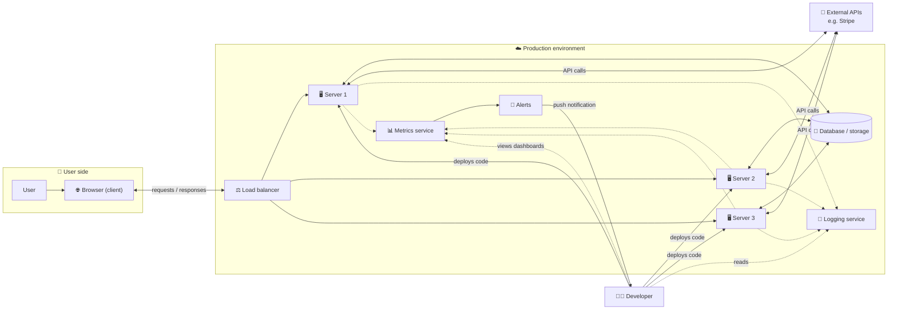
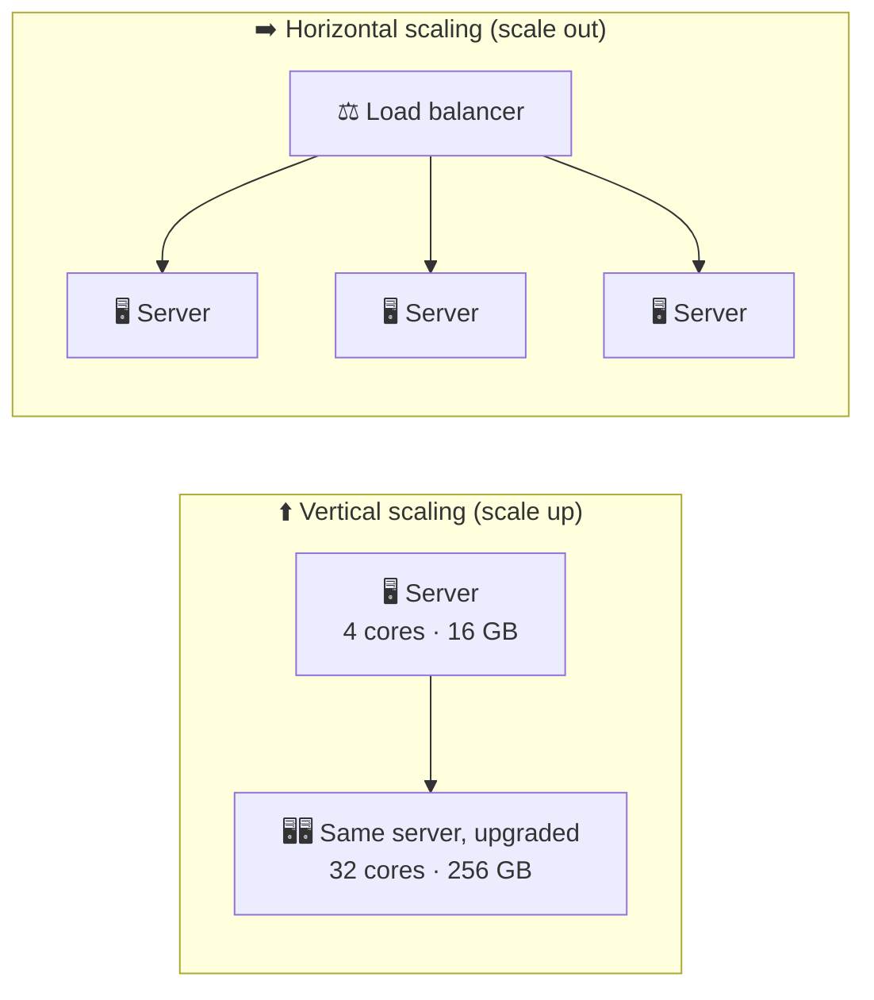
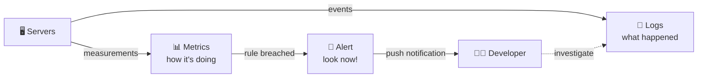

# 🏛️ Application Architecture

> [!abstract] 一句话总结 One-line summary
> 生产环境的应用不只是服务器上的代码：用户通过**负载均衡器访问多台服务器**，服务器与**存储和外部 API** 通信，开发者通过**日志、指标和告警**观察这一切。
> A production app is more than code on a server: users reach **many servers through a load balancer**, servers talk to **storage and external APIs**, and developers watch it all through **logs, metrics, and alerts**.

## 1. 太长不看 TL;DR

- 🖥️ **服务器 Server:** 处理其他计算机请求的计算机。开发者把代码部署到它上面。
  A computer that handles requests from other computers. Developers deploy code to it.
- 💾 **存储 Storage:** 应用数据通常放在**外部**数据库或云存储里，通过网络访问，这样所有服务器都能共享，某台服务器挂了数据也还在。
  App data usually lives in an **external** database or cloud storage, reached over the network, so every server can share it and it survives a server failure.
- 🌐 **客户端 Client:** 用户这一侧，通常是浏览器：发送请求，并渲染返回的 HTML/CSS/JavaScript 页面。
  The user's side, usually a web browser that sends requests and renders the HTML/CSS/JavaScript it gets back.
- 📈 **扩展 Scaling:** **垂直** = 换一台更大的机器；**水平** = 在**负载均衡器**后面加更多机器。
  **Vertical** = a bigger machine; **horizontal** = more machines behind a **load balancer**.
- 🔌 **外部 API External APIs:** 服务器会调用其他服务，比如用 Stripe 处理支付。
  Servers call other services, such as Stripe for payments.
- 🔍 **可观测性 Observability:** **日志**告诉你*发生了什么*，**指标**告诉你*系统状态如何*，**告警**告诉你*什么时候该看*。
  **Logs** say *what happened*, **metrics** say *how the system is doing*, **alerts** tell you *when to look*.

## 2. 全局视图 The Big Picture

> [!tip] 怎么看这张图 Reading the diagram
> **用户**通常只和入口（负载均衡器）打交道。**开发者**把代码部署到服务器，并查看日志、指标和告警。所有组件都通过**网络**相连。
> **Users** usually talk only to the front door (the load balancer). **Developers** deploy code to the servers and look at logs, metrics, and alerts. Everything is connected over a **network**.

## 3. 两个视角 Two Perspectives

### 3.1 🧑‍💻 开发者的视角 The developer's view

1. 开发者写代码，并把它**部署**到**服务器**上。
   Developers write code and **deploy** it to a **server**.
2. 服务器需要**持久化存储**来保存应用数据。
   The server needs **persistent storage** for the app's data.
3. 只存在某台服务器本地磁盘上的数据，没法和其他服务器共享，服务器挂了还会丢失，所以服务器通常通过网络访问**外部存储**（数据库或云存储）。
   Data kept only on one server's own disk can't be shared with other servers and is lost if that server fails, so servers usually talk to **external storage** (a database or cloud storage) over the network.

> [!note] 一句话说“服务器” "Server" in one line
> 目前可以这样理解：服务器是**处理另一台计算机请求**的计算机。（严格来说，“服务器”也可以指处理请求的那个程序。）
> For now: a server is a computer that **handles requests from another computer**. (Strictly, "server" can also mean the program doing the handling.)

### 3.2 👤 用户的视角 The user's view

1. 用户发起请求，通常通过**浏览器**。浏览器就是**客户端**。
   A user makes a request, usually through a **web browser**. The browser is the **client**.
2. 服务器返回响应。对于前端功能，它会发送浏览器显示页面所需的 **HTML、CSS 和 JavaScript** 文件。
   The server responds. For a front-end feature, it sends the **HTML, CSS, and JavaScript** the browser needs to show the page.
3. 用户多了，一台服务器就会成为**瓶颈**，通常卡在 **CPU**、**内存**、磁盘或网络上（见 [[Computer Architecture|计算机架构 Computer Architecture]]）。要保持速度，就必须**扩展**。
   With many users, one server becomes a **bottleneck**, usually its **CPU**, **RAM**, disk, or network (see [[Computer Architecture|计算机架构 Computer Architecture]]). To keep it fast, we must **scale**.

## 4. 📈 扩展服务器 Scaling the Server

| | ⬆️ 垂直扩展 Vertical scaling | ➡️ 水平扩展 Horizontal scaling |
| --- | --- | --- |
| 做法 What you do | 升级一台机器：更多内存、更多核、更快的 CPU 处理器 Upgrade one machine: more RAM, more cores, faster CPU | 增加运行相同代码的机器 Add more machines running the same code |
| 上限 Limit | 有硬上限：任何机器最终都会到顶 Hard ceiling: every machine maxes out eventually | 几乎没有上限：继续加服务器就行 Practically unlimited: keep adding servers |
| 硬件 Hardware | 昂贵的高端机器 Expensive high-end machines | 便宜的**通用硬件**（标准、廉价） Cheap **commodity hardware** (standard, inexpensive) |
| 服务器挂了 If a server dies | 如果这是唯一的服务器，整个应用就挂了（单点故障） The whole app is down if this is your only server (single point of failure) | 流量转到其余服务器 Traffic moves to the remaining servers |
| 工程成本 Engineering effort | 低：代码不用改 Low: the code doesn't change | 高：需要负载均衡器，服务器之间要协调 High: needs a load balancer, and servers must coordinate |
| 适合 Best for | 简单应用、早期阶段 Simple apps, early stages | 流量很大的大型系统 Large systems with lots of traffic |

> [!important] 经验法则 Rule of thumb
> 大型系统更倾向**水平**扩展：能力更强，容错也更好。但对简单应用来说，**垂直**扩展往往就够了，而且简单得多。
> Large systems prefer **horizontal** scaling: it's more powerful and more fault-tolerant. But **vertical** scaling is often enough for simple apps, and much easier.

> [!example] 真实案例：Prime Video 的迁移 Real-world example: Amazon Prime Video (2023)
> Prime Video 的一个监控服务从分布式的 **serverless/微服务**设计改回了单个**单体应用**，基础设施成本降低了约 90%。这个单体仍然跑在云上，仍然可以水平扩展；变化在于去掉了许多小组件之间昂贵的网络调用和数据传输。分布式程度越高不代表越好，这是一种权衡。
> One Prime Video monitoring service moved from a distributed **serverless/microservices** design to a single **monolith** and cut its infrastructure cost by about 90%. The monolith still ran on cloud infrastructure and could still be scaled out; what changed was removing costly network calls and data transfers between many small components. More distribution isn't automatically better; it's a trade-off.

### 4.1 ⚖️ 负载均衡器 Load balancer

有很多台服务器时，需要有东西决定**哪个请求交给哪台服务器**。这就是**负载均衡器**：它把进来的请求分散到一组服务器上。
With many servers, something has to decide **which server gets which request**. That's the **load balancer**: it spreads incoming requests across a group of servers.

- 它防止任何一台服务器过载。
  It keeps any one server from being overloaded.
- 某台服务器挂了，它就不再把流量发过去。
  It stops sending traffic to a server that goes down.
- 常见策略：**轮询**（轮流分配）、**最少连接**（发给最闲的服务器）。
  Common strategies: **round robin** (take turns), **least connections** (send to the least busy server).
- 负载均衡器本身也可能成为单点故障，所以生产环境通常会部署不止一个。
  The load balancer could itself become a single point of failure, so production setups usually run more than one.

> [!warning] 水平扩展的一个坑 A catch with horizontal scaling
> 任何请求都可能落到任何一台服务器上，所以服务器应该是**无状态的**：会话这类共享数据要放在数据库或共享缓存里，而不是某台服务器的内存里。
> Any request can land on any server, so servers should be **stateless**: keep shared data such as sessions in the database or a shared cache, not in one server's memory.

### 4.2 🔌 外部 API External APIs

服务器不是孤立存在的。它们经常通过 API 调用**其他公司的服务**。比如 [neetcode.io](https://neetcode.io) 用 **Stripe** 处理支付。对外部服务来说，你的服务器就是客户端。
Servers don't live in isolation. They often call **other companies' services** through APIs. For example, [neetcode.io](https://neetcode.io) uses **Stripe** for payments. To the external service, your server is the client.

## 5. 🔍 日志、指标和告警 Logging, Metrics, and Alerts

| | 📜 日志 Logs | 📊 指标 Metrics | 🚨 告警 Alerts |
| --- | --- | --- | --- |
| 回答的问题 Answers | 发生了什么？ What happened? | 系统状态如何？ How is the system doing? | 我现在需要看吗？ Do I need to look right now? |
| 内容 Contents | 单个事件的记录：请求、错误、崩溃前发生了什么 Records of individual events: requests, errors, what happened before a crash | 随时间变化的数值：CPU、内存、网络流量、成功率 Numbers over time: CPU usage, RAM usage, network traffic, success rate | 一条触发通知的规则，通常基于指标，例如“成功率低于 95%” A rule that fires a notification, usually on a metric, e.g. "success rate < 95%" |
| 存在哪 Where | 写在服务器本地，或（更可靠地）写到**外部**日志服务器 Written to the server itself, or (more reliably) to an **external** logging server | 从整个环境的多个来源收集 Collected from many sources across the environment | 以推送通知发给开发者 Sent as a push notification to developers |
| 适合 Good for | 排查某一次具体故障 Debugging a specific failure | 发现瓶颈和趋势 Spotting bottlenecks and trends | 不用整天盯着仪表盘 Not having to watch dashboards all day |

> [!tip] 为什么日志要写到外部服务器 Why logs go to an external server
> 如果服务器崩溃或磁盘损坏，存在它上面的日志可能会丢失，而这恰恰是你最需要它们的时候。
> If the server crashes or its disk dies, logs stored on it may be lost, exactly when you need them most.

**告警的实际用法 Alerts in practice:** 手动查看指标，就像每 5 分钟看一次手机有没有新消息。更好的做法是设置一条规则，收到**推送通知**。例如：平时 100% 的请求都成功，那就在成功率**低于 95%** 时告警。
Checking metrics by hand is like checking your phone every 5 minutes for a message. Instead, set a rule and get a **push notification**. For example: normally 100% of requests succeed, so alert when the success rate drops **below 95%**.

## 6. 🌐 接下来 What's Next

这些组件可能运行在**不同的计算机**上，所以它们要通过**网络**通信。这引出了课程接下来的问题：
All these parts may run on **different computers**, so they talk over a **network**. That raises the next questions in the course:

- 组件之间怎么通信？
  How do the components communicate?
- 它们遵循哪些**协议**？
  Which **protocols** do they follow?
- 这些协议可以怎么优化？
  How can those protocols be optimized?

## 7. ⚠️ 对课程原文的澄清 Clarifications to the Lesson Text

- **“负载均衡器会*均匀*分配请求” "A load balancer will *evenly* distribute requests":** 它按某种策略*分散*请求，“均匀”取决于你衡量什么。轮询让每台服务器得到大致相同数量的请求；最少连接偏向当前最闲的服务器；加权策略会故意给更大的服务器更多流量。
  It *spreads* requests by a strategy, and "even" depends on what you measure. Round robin gives each server a roughly equal number of requests. Least connections favors whichever server is least busy right now. Weighted strategies deliberately send more traffic to bigger servers.
- **“Prime Video 从微服务迁移到了单体” "Amazon Prime Video migrated from microservices to a monolith":** 这只是 **一个监控服务**（2023 年），不是整个 Prime Video，而且它是从 serverless 分布式设计迁出的。要学的是“选能用的最简单架构”，而不是“单体胜过微服务”。
  It was **one monitoring service** (in 2023), not Prime Video as a whole, and it moved away from a serverless, distributed design. The lesson is "pick the simplest architecture that works", not "monoliths beat microservices".
- **水平扩展不是免费的 Horizontal scaling isn't free:** 课程提到了额外的工程成本。其中最大的部分通常是让服务器**无状态**，并保持它们之间的数据一致。
  The lesson mentions the extra engineering effort. The biggest part is usually making servers **stateless** and keeping data consistent across them.

## 8. 🧩 复习题 Review Questions

**Q1.** 垂直扩展和水平扩展有什么区别？ What is the difference between vertical and horizontal scaling?

> [!success]- 答案 Answer
> 垂直扩展是升级单台机器（更多内存、更多或更快的 CPU 核）。水平扩展是增加运行相同代码的机器，并用负载均衡器把请求分散到这些机器上。
> Vertical scaling upgrades a single machine (more RAM, more or faster CPU cores). Horizontal scaling adds more machines running the same code, with a load balancer spreading requests across them.

**Q2.** 为什么大型系统通常更倾向水平扩展？ Why do large systems usually prefer horizontal scaling?

> [!success]- 答案 Answer
> 它几乎没有上限（继续加服务器即可），用便宜的通用硬件，而且某台服务器挂了流量会转到其他服务器，系统还能运行。代价是更多的工程成本。
> It has practically no ceiling (just keep adding servers), uses cheap commodity hardware, and survives a server failure because traffic moves to the other servers. The trade-off is more engineering effort.

**Q3.** 什么时候垂直扩展可能是更好的选择？ When might vertical scaling be the better choice?

> [!success]- 答案 Answer
> 对简单或早期的应用：不需要改代码，服务器之间也不需要协调，而且往往就够用了。
> For simple or early-stage apps: it needs no code changes and no coordination between servers, and it is often enough.

**Q4.** 负载均衡器做什么？ What does a load balancer do?

> [!success]- 答案 Answer
> 它决定每个进来的请求由哪台服务器处理，把负载分散到一组服务器上，并跳过已经挂掉的服务器。
> It decides which server handles each incoming request, spreading load across a group of servers and skipping servers that are down.

**Q5.** 日志和指标有什么区别？ What is the difference between logs and metrics?

> [!success]- 答案 Answer
> 日志记录单个事件（发生了什么、错误、崩溃前的经过）。指标是随时间变化的数值（CPU、内存、网络、成功率），显示系统状态如何、瓶颈在哪里。
> Logs record individual events (what happened, errors, what led up to a crash). Metrics are numbers over time (CPU, RAM, network, success rate) that show how the system is doing and where the bottlenecks are.

**Q6.** 为什么要把日志写到外部服务器？ Why write logs to an external server?

> [!success]- 答案 Answer
> 如果服务器崩溃或磁盘损坏，存在它上面的日志可能会丢失。外部日志服务器能让日志在排查问题时仍然可用。
> If the server crashes or its disk fails, logs stored on it could be lost. An external log server keeps them available for debugging.

**Q7.** 为什么用告警，而不是盯着指标？ Why use alerts instead of watching metrics?

> [!success]- 答案 Answer
> 没有人能整天盯着仪表盘。告警是基于指标的一条规则，比如“成功率低于 95%”，只在需要关注时才发推送通知。
> Nobody can watch dashboards all day. An alert is a rule on a metric, such as "success rate below 95%", that sends a push notification only when something needs attention.

**Q8.** 水平扩展时，为什么服务器应该是无状态的？ Why should servers be stateless when scaling horizontally?

> [!success]- 答案 Answer
> 负载均衡器可能把每个请求发给任何一台服务器。如果会话数据存在某台服务器的内存里，下一个请求可能落到没有这份数据的服务器上。共享状态应该放在数据库或共享缓存里。
> The load balancer can send each request to any server. If session data lived in one server's memory, the next request might hit a server that doesn't have it. Shared state belongs in a database or shared cache.

## 9. 🔗 相关 Related

- ⬅️ 上一篇 Previous: [[Computer Architecture|计算机架构 Computer Architecture]]
- [[📌 系统设计总览|系统设计总览 System Design Overview]]
- ➡️ 下一篇 Next: [[Design Requirements|设计需求 Design Requirements]]
- 即将学习：网络和协议
  Coming up: networking and protocols
