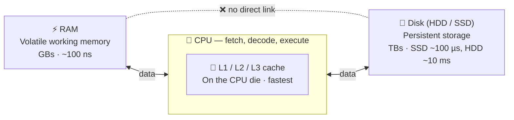
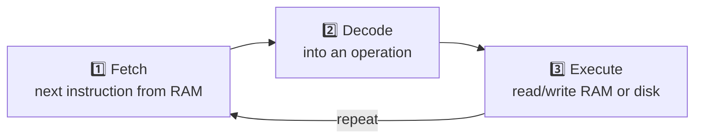
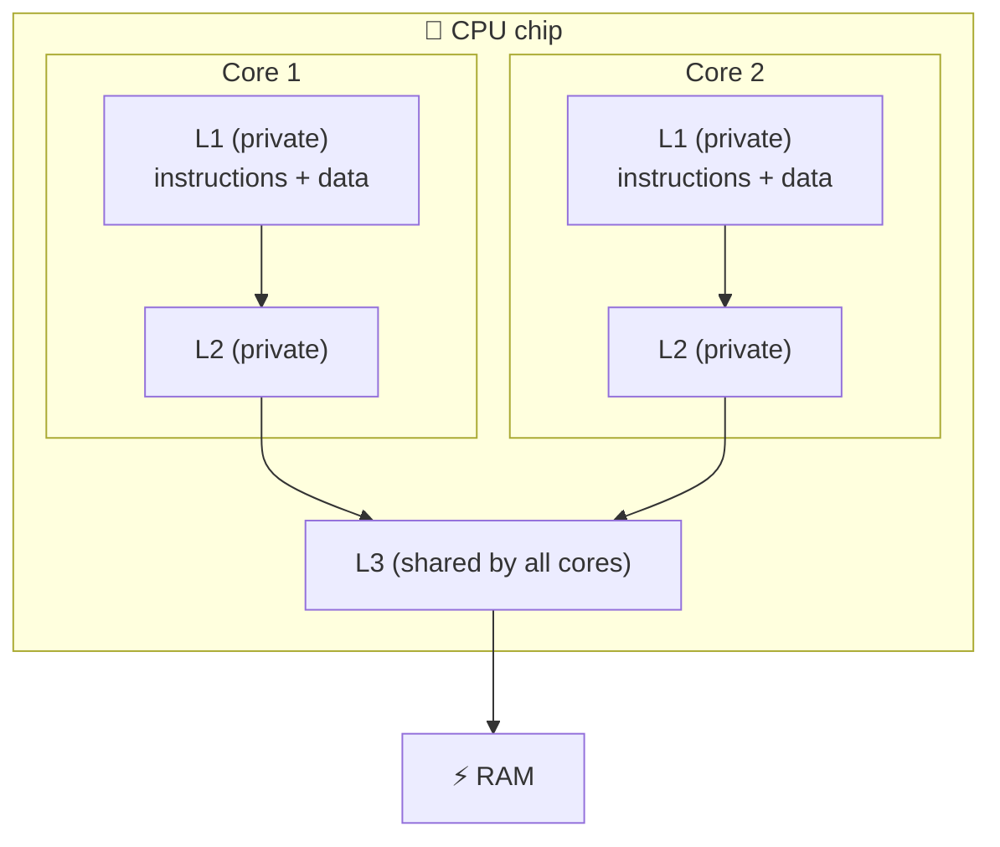
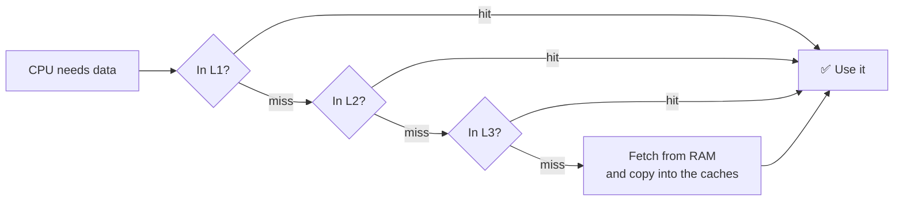
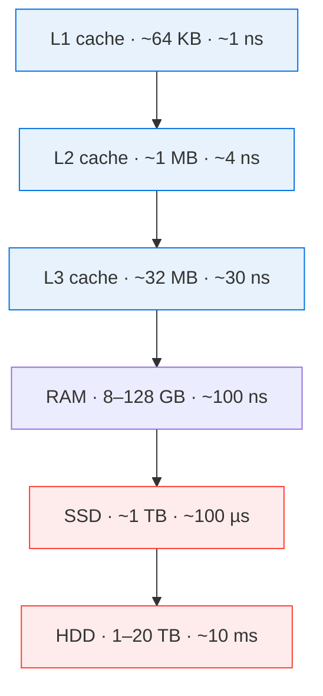

# 🖥️ Computer Architecture

> [!abstract] 一句话总结 One-line summary
> 存储是一种权衡：**存储越快，就越小、越贵**。CPU 位于中间，在各层之间搬运数据。
> Storage is a trade-off: **the faster the memory, the smaller and more expensive it is**. The CPU sits in the middle and moves data between the layers.

## 1. 太长不看 TL;DR

- 💾 **磁盘 Disk** (HDD/SSD): 容量巨大（TB 级）、便宜、慢、**持久化**。
  Huge (TBs), cheap, slow, **persistent**.
- ⚡ **内存 RAM:** 容量中等（GB 级）、快、**易失**。存放正在运行的程序和它们的变量。
  Medium (GBs), fast, **volatile**. It holds running programs and their variables.
- 🚀 **CPU 缓存 CPU cache** (L1/L2/L3): 很小（KB 到几十 MB）、最快，每次读取都先查它。
  Tiny (KBs to tens of MBs), fastest, checked first on every read.
- 🧠 **处理器 CPU:** 执行指令，并协调内存和磁盘之间的数据传输；它们不会自己直接通信。
  Executes instructions and coordinates data transfers between RAM and disk; they don't talk to each other on their own.
- 📈 **摩尔定律 Moore's Law:** 晶体管数量大约每 2 年翻一番。时钟频率已经进入平台期。
  Transistor counts double about every 2 years. Clock speed has plateaued.

## 2. 单位复习 Units Refresher

**比特**（0 或 1）是最小单位。1 **字节** = 8 比特。
A **bit** (0 or 1) is the smallest unit. 1 **byte** = 8 bits.

| 容量单位 Size unit | 字节 Bytes | 例子 Example |
| --- | --- | --- |
| KB (kilobyte) | $10^3$ | CPU L1 缓存 CPU L1 cache |
| MB (megabyte) | $10^6$ | CPU L3 缓存 CPU L3 cache |
| GB (gigabyte) | $10^9$（十亿 one billion） | 内存、U 盘 RAM, USB drive |
| TB (terabyte) | $10^{12}$（万亿 one trillion） | 磁盘 Disk |

| 时间单位 Time unit | 秒 Seconds | 典型场景 Typical for |
| --- | --- | --- |
| 毫秒 Millisecond (ms) | $1/10^3$ | 机械硬盘访问（SSD 约 100 µs） HDD access (an SSD takes ~100 µs) |
| 微秒 Microsecond (µs) | $1/10^6$ | 向内存写入 1 MB 数据 Writing 1 MB to RAM |
| 纳秒 Nanosecond (ns) | $1/10^9$ | 内存访问、CPU 指令、缓存命中 RAM access, CPU instruction, cache hit |

## 3. 各部分如何连接 How the Parts Connect

> [!important] 关键规则 Key rule
> 内存和磁盘**不会自己直接通信**。它们之间的每次传输都由 CPU 协调。
> RAM and disk **don't talk to each other on their own**. The CPU orchestrates every transfer between them.
>
> 在真实硬件里，**DMA**（直接内存访问）让磁盘控制器把数据复制到内存，而不需要 CPU 逐字节搬运。传输仍然由 CPU 发起和管理。
> In real hardware, **DMA** (Direct Memory Access) lets the disk controller copy data into RAM without the CPU moving each byte. The CPU still starts and manages the transfer.

读取时，CPU 按 **缓存 → 内存 → 磁盘** 的顺序查找。
On a read, the CPU checks **cache → RAM → disk**, in that order.

## 4. 组件 Components

### 4.1 💾 磁盘 Disk

磁盘是计算机主要的**持久化**存储。无论开机还是关机，数据都还在。现代磁盘能存 TB 级数据，U 盘是 GB 级。
The disk is the computer's primary **persistent** storage. Data survives whether the machine is on or off. Modern disks hold TBs. A USB drive holds GBs.

| | 机械硬盘 HDD (hard disk drive) | 固态硬盘 SSD (solid-state drive) |
| --- | --- | --- |
| 原理 How it works | 机械式：旋转的盘片 + 读写磁头 Mechanical: spinning platters + a read/write head | 电子闪存芯片，没有活动部件（和内存不同，断电不丢数据） Electronic flash memory chips, no moving parts (unlike RAM, keeps data without power) |
| 速度 Speed | 较慢 Slower | 快得多 Much faster |
| 老化 Aging | 机械磨损会让它越来越慢 Wear and tear slows it down over time | 没有机械磨损（闪存单元在大量写入后也会损耗，但很慢） No mechanical wear (flash cells do wear out after many writes, but slowly) |
| 成本 Cost | 每 GB 更便宜 Cheaper per GB | 更贵 Costs more |
| 普及度 Popularity | 在下降 Declining | 现在是常见默认选择 Now the common default |

### 4.2 ⚡ 内存 RAM (Random Access Memory)

内存是快速、**易失**的工作内存，正在运行的程序就在这里。关机时内容会被清除，所以你要把工作保存到磁盘上。
RAM is the fast, **volatile** working memory where running programs live. Its contents are erased when the computer shuts down, which is why you save work to disk.

- **容量 Size:** 通常 1 GB 到 128 GB。按字节算比磁盘贵得多。
  Typically 1 GB to 128 GB. It is much more expensive per byte than disk.
- **速度 Speed:** 写 1 MB，内存需要微秒级，机械硬盘需要毫秒级，大约**快 1,000 倍**。
  Writing 1 MB takes microseconds in RAM vs milliseconds on an HDD, about **1,000× faster**.
- **存放 Holds:** 打开的应用，以及程序分配的变量。
  Open applications and the variables your program allocates.

> [!note] 注意 Note
> 这些数字是粗略估计，会随硬件进步而变化。
> These numbers are rough estimates and change as hardware improves.

### 4.3 🧠 处理器 CPU (Central Processing Unit)

CPU 是计算机的“大脑”。它负责所有计算，并读写内存和磁盘。
The CPU is the "brain" of the computer. It does every computation and reads and writes both RAM and disk.

运行代码时，代码会被翻译成二进制指令存放在内存中。然后 CPU 不断重复一个循环：
When you run code, it is translated into binary instructions stored in RAM. The CPU then repeats one cycle:

在最底层，每条指令都只是字节。CPU 在同一块芯片（die）上还集成了**缓存**。
At the lowest level, every instruction is just bytes. The CPU also contains a **cache** on the same chip (die).

### 4.4 🚀 缓存 Caches

缓存把常用数据的一小份副本放在更快的存储里，让大多数读取不用走慢路。
A cache keeps a small copy of frequently used data in faster storage, so most reads skip the slow trip.

**CPU 缓存 CPU caches** (L1, L2, L3)

- 比内存快得多，但只能存 KB 到几十 MB。L1 最小最快；L3 最大最慢。
  Much faster than RAM, but they store only KBs to tens of MBs. L1 is the smallest and fastest; L3 is the largest and slowest.
- 读取时先查缓存，再查内存和磁盘。**缓存命中**（数据在缓存里且仍然有效）就不用去内存了。
  On a read, the cache is checked before RAM and disk. A **cache hit** (the data is present and still valid) avoids going to RAM.
- 它们快，一部分因为就在 CPU 芯片上，一部分因为用 **SRAM** 制造。主内存用的是 DRAM。SRAM 更快，但每比特需要更多晶体管，所以更贵、更占地方。
  They are fast partly because they sit on the CPU die and partly because they are built from **SRAM**. Main memory uses DRAM. SRAM is faster but needs more transistors per bit, so it is costlier and bulkier.

**硬件之外的缓存 Caching beyond hardware**

- 浏览器会缓存 HTML、CSS、JavaScript 和图片，让再次访问加载更快。
  A web browser caches HTML, CSS, JavaScript, and images so repeat visits load faster.
- 浏览器会为当前会话保留一个小的内存缓存，但主缓存在**磁盘**上。磁盘比内存慢，但比网络请求快。
  Browsers keep a small memory cache for the current session, but the main cache lives on **disk**. Disk is slow next to RAM but fast next to a network request.

> [!tip] 通用模式 General pattern
> 缓存 = 把数据放到比慢速来源**更近一层**的地方。
> Cache = put the data **one level closer** than the slow source.

### 4.5 🧱 L1 / L2 / L3 缓存一览 L1 / L2 / L3 Cache at a Glance

现代 CPU 有多个**核心**，三级缓存围绕它们排列。每个核心有自己小而快的 L1 和 L2，所有核心共享一个更大的 L3。
Modern CPUs have several **cores**, and the three cache levels are arranged around them. Each core has its own small, fast L1 and L2. All cores share one larger L3.

| 级别 Level | 典型大小 Typical size | 典型延迟 Typical latency | 共享？ Shared? | 作用 Role |
| --- | --- | --- | --- | --- |
| **L1** | 每核 32–64 KB 左右 About 32–64 KB per core | 约 1 ns（几个周期） ~1 ns (a few cycles) | 单核私有 Private to one core | 分为指令缓存和数据缓存，存放核心当前正在用的东西 Split into an instruction cache and a data cache. Holds what the core is using right now |
| **L2** | 每核 256 KB–2 MB 左右 About 256 KB–2 MB per core | ~4 ns | 单核私有 Private to one core | L1 的后备，接住 L1 大部分未命中 Backup for L1. Catches most of what L1 misses |
| **L3** | 每芯片 8–64 MB 左右 About 8–64 MB per chip | ~10–40 ns | 所有核心共享 Shared by all cores | 去内存前的最后一站，让核心之间不用经过内存就能共享数据 Last stop before RAM. Lets cores share data without a trip to memory |

> [!note] 注意 Note
> 大小和延迟是现代 CPU 的典型值，不同型号差别很大。
> Sizes and latencies are typical modern values and vary a lot by CPU model.

**查找过程 How a lookup works**

**关键概念 Key ideas**

- **命中与未命中 Hit vs miss:** *命中*是在这一级找到了数据。*未命中*就落到下一级更慢的地方。一路未命中到内存，代价约是 L1 命中的 100 倍。
  A *hit* finds the data at that level. A *miss* falls through to the next, slower level. A miss all the way to RAM costs about 100× an L1 hit.
- **缓存行 Cache line:** 数据在各级之间按固定大小的块移动，通常是 **64 字节**，而不是一次一个字节。读一个值也会把它的邻居一起带进来。
  Data moves between levels in fixed blocks, usually **64 bytes**, not one byte at a time. Reading one value also brings its neighbors along.
- **局部性 Locality:** 这是缓存有效的原因：
  This is why caches work:
    - *时间局部性*：最近用过的数据很可能很快再用，比如循环计数器。
      *Temporal*: data used recently is likely to be used again soon, such as a loop counter.
    - *空间局部性*：最近用过的数据附近的数据很可能接着用，比如数组的下一个元素。
      *Spatial*: data near recently used data is likely next, such as the next element of an array.
- **由硬件管理 Managed by hardware:** 程序不能决定什么放进 L1/L2/L3。CPU 自动决定，并自动淘汰旧数据。
  Programs don't choose what goes in L1/L2/L3. The CPU decides and evicts old data automatically.

> [!example] 为什么程序员要关心 Why programmers care
> 按顺序遍历数组很快：每个 64 字节的缓存行能服务好几个元素（空间局部性）。在内存里随机跳，比如沿着链表指针走，会产生很多未命中，同样的工作量可能慢好几倍（常见 2–10 倍）。
> Iterating an array in order is fast: each 64-byte cache line serves several elements (spatial locality). Jumping randomly through memory, such as following linked-list pointers, causes many misses and can be several times slower (often 2–10×) for the same amount of work.

## 5. 存储层级 The Memory Hierarchy

⬇️ 越往下：**越大、每字节越便宜、越慢**。最大的跳跃是从内存到 SSD，大约慢 **1,000 倍**。
⬇️ Going down: **bigger, cheaper per byte, slower**. The biggest jump is RAM → SSD, about **1,000×** slower.

> [!info] 这些数字的来源 Source of these figures
> 这些延迟和容量是现代计算机的近似值，是为了提供背景补充的。课程本身只给了微秒（内存）和毫秒（磁盘）的对比。
> The latency and size figures are approximate values for a modern computer, added for context. The lesson itself only gave µs (RAM) vs ms (disk).

## 6. 📈 摩尔定律 Moore's Law

摩尔定律是一个观察，而不是物理定律：**芯片上的晶体管数量大约每两年翻一番**。在对数坐标图上，这种增长是一条直线，也就是说它是指数增长。
Moore's Law is an observation, not a physical law: **the number of transistors on a chip doubles about every two years**. Plotted on a log-scale chart, the growth shows up as a straight line, which means it is exponential.

| 年份 Year | 芯片 Chip | 晶体管数（约） Transistors (approx.) |
| --- | --- | --- |
| 1971 | Intel 4004 | 2,300 |
| 1978 | Intel 8086 | 29,000 |
| 1985 | Intel 386 | 275,000 |
| 1989 | Intel 486 | 1.2M |
| 1993 | Pentium | 3.1M |
| 2000 | Pentium 4 | 42M |
| 2006 | Core 2 Duo | 291M |
| 2010 | Core i7-980X | 1.17B |
| 2020 | Apple M1 | 16B |
| 2023 | Apple M2 Ultra | 134B |

$$
N(t) \approx N_0 \times 2^{(t - t_0)/2}
$$

从 1971 年的 2,300 个出发，这个公式预测 2023 年约 1,500 亿个。M2 Ultra（两块 die 封装成一颗芯片）约有 1,340 亿个，所以趋势大致成立，只是近年的芯片略低于这条线。
From 2,300 in 1971, that formula predicts about 150B by 2023. The M2 Ultra (two dies joined into one package) has about 134B, so the trend roughly holds, though recent chips sit slightly below the line.

> [!warning] 真正停滞的是什么 What actually plateaued
> 大约从 2005 年起，**时钟频率**不再上升，单核性能提升也明显放缓，但晶体管数量还在增长。多出来的晶体管现在用来做更多核心和更大的缓存。想要更快，就要并行，或者用更多机器，这就引出了分布式系统。
> Since about 2005, **clock speed** has stopped climbing and single-core gains have slowed sharply, though transistor count kept growing. Extra transistors now go into more cores and bigger caches. To go faster, you work in parallel or on more machines, which leads to distributed systems.

## 7. ⚠️ 对课程原文的更正 Corrections to the Lesson Text

- **“CPU 计算需要毫秒” "CPU computations take milliseconds":** 慢了大约一百万倍。一条 CPU 指令不到一**纳秒**；现代 CPU 每秒能执行几十亿条。
  Too slow by about a million. A single CPU instruction takes under a **nanosecond**; a modern CPU runs billions per second.
- **“操作系统决定什么放进 CPU 缓存” "The operating system decides what goes in the CPU cache":** L1/L2/L3 由**硬件**自动管理。操作系统管理的是其他缓存，比如磁盘文件的页缓存。
  L1/L2/L3 are managed by the **hardware** automatically. The OS manages other caches, such as the page cache for disk files.
- **“计算机的成本减半” "The cost of computers halves":** 摩尔定律说的是晶体管数量。每个晶体管的计算成本降低是它带来的结果，但“成本减半”不是定律本身的内容。
  Moore's Law is about transistor count. Cheaper computing per transistor followed from it, but halving cost is not part of the law itself.
- **“内存和磁盘依赖 CPU 传输数据” "RAM and disk rely on the CPU to transfer data":** 作为心智模型没错，但有了 **DMA**，磁盘控制器会直接把数据复制到内存。CPU 只负责发起和管理传输。
  True as a mental model, but with **DMA** the disk controller copies data into RAM directly. The CPU only starts and manages the transfer.

## 8. 🏗️ 这对系统设计意味着什么 Why This Matters for System Design

速度、容量、成本和持久性之间的同一种权衡，在整个系统的尺度上会再次出现：
The same trade-off between speed, size, cost, and durability appears again at the scale of whole systems:

| 计算机层面 Computer level | 系统设计中的对应 System design equivalent | 为什么对应 Why they match |
| --- | --- | --- |
| CPU 缓存 CPU cache (L1/L2/L3) | 进程内缓存，例如应用里的 LRU 映射 In-process cache, e.g. an LRU map inside the app | 最小最快，紧挨着代码，只属于一个进程或一台机器（像每个核心私有的一、二级缓存） Smallest and fastest, sits right next to the code, private to one process or machine (like a core's private L1/L2) |
| 内存 RAM | 共享缓存，例如 Redis、Memcached 服务 Shared cache, e.g. Redis, Memcached | 快但易失，被很多应用服务器共享（像被所有核心共享的 L3），隔一跳网络 Fast but volatile, shared by many app servers (like L3 shared by cores), one network hop away |
| 磁盘 Disk | 数据库、对象存储 Databases, object storage | 慢但持久：真实数据的来源 Slow but durable: the source of truth |
| 摩尔定律放缓 Moore's Law slowdown | 分布式系统 Distributed systems | 单台机器不再变快，所以扩展到多台 One machine stops getting faster, so scale out to many |

每个请求：先查进程内缓存 → 再查 Redis → 最后查数据库。这和硬件层级一样：最近最小的先查，持久的真实数据源最后查。
On every request: check the in-process cache → then Redis → then the database. This mirrors the hardware hierarchy: closest and smallest first, the durable source of truth last.

> [!note] CDN 和浏览器缓存放在哪 Where CDNs and browser caches fit
> 它们和 CPU 缓存不对应。它们缩短的是**到用户的网络距离**（地理位置），而不是内存和处理器之间的距离。它们遵循同样的一般原则（“把数据放到离读取者更近一层的地方”），只是沿着不同的维度。
> These don't map to the CPU cache. They cut **network distance to the user** (geography), not the distance between memory and processor. They follow the same general principle ("put data one level closer to whoever reads it"), but along a different axis.

## 9. 🧩 复习题 Review Questions

**Q1.** 为什么内存不能完全取代磁盘？ Why can't RAM replace disk entirely?

> [!success]- 答案 Answer
> 内存是易失的（断电丢数据），而且按字节算贵得多。
> RAM is volatile (it loses data on power off) and much more expensive per byte.

**Q2.** 哪个组件在内存和磁盘之间搬运数据？ What component moves data between RAM and disk?

> [!success]- 答案 Answer
> 由 CPU 协调。内存和磁盘不会自己通信（有 DMA 时由磁盘控制器复制数据，但仍由 CPU 发起和管理）。
> The CPU coordinates it. RAM and disk don't communicate on their own (with DMA, the disk controller does the copying, but the CPU still starts and manages it).

**Q3.** 读取时，缓存、内存、磁盘按什么顺序检查？ In what order are cache, RAM, and disk checked on a read?

> [!success]- 答案 Answer
> 缓存 → 内存 → 磁盘。
> Cache → RAM → disk.

**Q4.** 为什么浏览器把主缓存放在磁盘而不是内存？ Why does a browser keep its main cache on disk instead of RAM?

> [!success]- 答案 Answer
> 浏览器会为当前会话保留内存缓存，但主缓存放在磁盘上，这样重启后还在，而且可以大得多。磁盘仍然比网络请求快得多。
> Browsers keep a memory cache for the current session, but the main cache is on disk so it survives restarts and can be much larger. Disk is still far faster than a network request.

**Q5.** 为什么 SSD 比 HDD 快？ Why is an SSD faster than an HDD?

> [!success]- 答案 Answer
> SSD 用电子方式读写。HDD 必须物理移动读写磁头，在旋转的盘片上寻找数据。
> An SSD reads and writes electronically. An HDD must physically move a read/write head over spinning platters.

**Q6.** 哪几级缓存是核心私有的，哪一级是共享的？ Which cache levels are private to a core, and which is shared?

> [!success]- 答案 Answer
> L1 和 L2 是每个核心私有的。L3 由芯片上所有核心共享。
> L1 and L2 are private to each core. L3 is shared by all cores on the chip.

**Q7.** 为什么按顺序遍历数组比沿着链表指针走更快？ Why is looping over an array in order faster than following linked-list pointers?

> [!success]- 答案 Answer
> 数据按 64 字节的缓存行移动，一次读取就带进好几个相邻的数组元素（空间局部性）。链表节点散落在内存各处，所以很多步都可能未命中缓存。
> Data moves in 64-byte cache lines, so one fetch brings in several neighboring array elements (spatial locality). Linked-list nodes are scattered in memory, so many steps can be cache misses.

## 10. 🔗 相关 Related

- [[📌 系统设计总览|系统设计总览 System Design Overview]]
- ➡️ 下一篇 Next: [[Application Architecture|应用架构 Application Architecture]]
