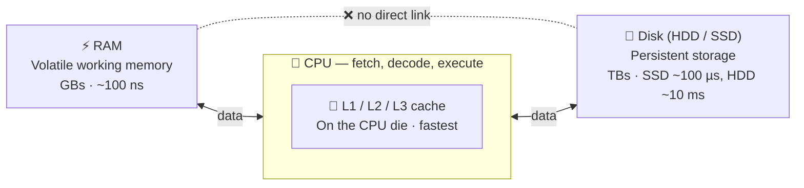
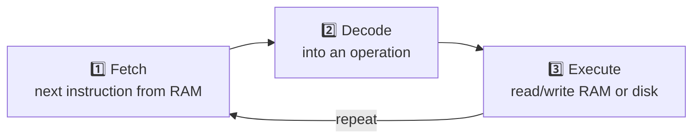
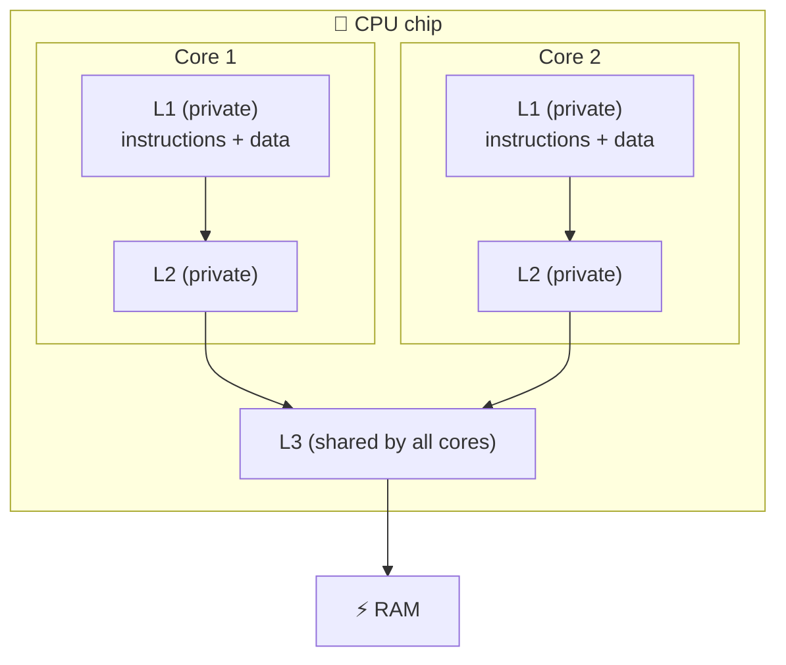
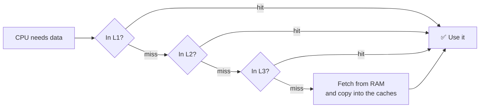
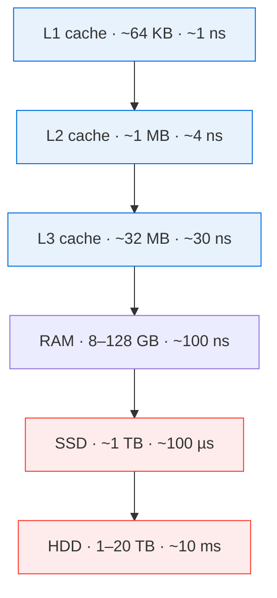

# 🖥️ Computer Architecture

> [!abstract] One-line summary
> Storage is a trade-off: **the faster the memory, the smaller and more expensive it is**. The CPU sits in the middle and moves data between the layers.

## 1. TL;DR

- 💾 **Disk** (HDD/SSD): huge (TBs), cheap, slow, **persistent**.
- ⚡ **RAM**: medium (GBs), fast, **volatile**. It holds running programs and their variables.
- 🚀 **CPU cache** (L1/L2/L3): tiny (KBs to tens of MBs), fastest, checked first on every read.
- 🧠 **CPU**: executes instructions and coordinates data transfers between RAM and disk; they don't talk to each other on their own.
- 📈 **Moore's Law**: transistor counts double about every 2 years. Clock speed has plateaued.

## 2. Units Refresher

A **bit** (0 or 1) is the smallest unit. 1 **byte** = 8 bits.

| Size unit | Bytes | Example |
| --- | --- | --- |
| KB (kilobyte) | $10^3$ | CPU L1 cache |
| MB (megabyte) | $10^6$ | CPU L3 cache |
| GB (gigabyte) | $10^9$ (one billion) | RAM, USB drive |
| TB (terabyte) | $10^{12}$ (one trillion) | Disk |

| Time unit | Seconds | Typical for |
| --- | --- | --- |
| Millisecond (ms) | $1/10^3$ | HDD access (an SSD takes ~100 µs) |
| Microsecond (µs) | $1/10^6$ | Writing 1 MB to RAM |
| Nanosecond (ns) | $1/10^9$ | RAM access, CPU instruction, cache hit |

## 3. How the Parts Connect

> [!important] Key rule
> RAM and disk **don't talk to each other on their own**. The CPU orchestrates every transfer between them.
>
> In real hardware, **DMA** (Direct Memory Access) lets the disk controller copy data into RAM without the CPU moving each byte. The CPU still starts and manages the transfer.

On a read, the CPU checks **cache → RAM → disk**, in that order.

## 4. Components

### 4.1 💾 Disk

The disk is the computer's primary **persistent** storage. Data survives whether the machine is on or off. Modern disks hold TBs. A USB drive holds GBs.

| | HDD (hard disk drive) | SSD (solid-state drive) |
| --- | --- | --- |
| How it works | Mechanical: spinning platters + a read/write head | Electronic flash memory chips, no moving parts (unlike RAM, keeps data without power) |
| Speed | Slower | Much faster |
| Aging | Wear and tear slows it down over time | No mechanical wear (flash cells do wear out after many writes, but slowly) |
| Cost | Cheaper per GB | Costs more |
| Popularity | Declining | Now the common default |

### 4.2 ⚡ RAM (Random Access Memory)

RAM is the fast, **volatile** working memory where running programs live. Its contents are erased when the computer shuts down, which is why you save work to disk.

- **Size:** typically 1 GB to 128 GB. It is much more expensive per byte than disk.
- **Speed:** writing 1 MB takes microseconds in RAM vs milliseconds on an HDD, about **1,000× faster**.
- **Holds:** open applications and the variables your program allocates.

> [!note]
> These numbers are rough estimates and change as hardware improves.

### 4.3 🧠 CPU (Central Processing Unit)

The CPU is the "brain" of the computer. It does every computation and reads and writes both RAM and disk.

When you run code, it is translated into binary instructions stored in RAM. The CPU then repeats one cycle:

At the lowest level, every instruction is just bytes. The CPU also contains a **cache** on the same chip (die).

### 4.4 🚀 Caches

A cache keeps a small copy of frequently used data in faster storage, so most reads skip the slow trip.

**CPU caches (L1, L2, L3)**
- Much faster than RAM, but they store only KBs to tens of MBs. L1 is the smallest and fastest; L3 is the largest and slowest.
- On a read, the cache is checked before RAM and disk. A **cache hit** (the data is present and still valid) avoids going to RAM.
- They are fast partly because they sit on the CPU die and partly because they are built from **SRAM**. Main memory uses DRAM. SRAM is faster but needs more transistors per bit, so it is costlier and bulkier.

**Caching beyond hardware**
- A web browser caches HTML, CSS, JavaScript, and images so repeat visits load faster.
- Browsers keep a small memory cache for the current session, but the main cache lives on **disk**. Disk is slow next to RAM but fast next to a network request.

> [!tip] General pattern
> Cache = put the data **one level closer** than the slow source.

### 4.5 🧱 L1 / L2 / L3 Cache at a Glance

Modern CPUs have several **cores**, and the three cache levels are arranged around them. Each core has its own small, fast L1 and L2. All cores share one larger L3.

| Level | Typical size | Typical latency | Shared? | Role |
| --- | --- | --- | --- | --- |
| **L1** | ~32–64 KB per core | ~1 ns (a few cycles) | Private to one core | Split into an instruction cache and a data cache. Holds what the core is using right now |
| **L2** | ~256 KB–2 MB per core | ~4 ns | Private to one core | Backup for L1. Catches most of what L1 misses |
| **L3** | ~8–64 MB per chip | ~10–40 ns | Shared by all cores | Last stop before RAM. Lets cores share data without a trip to memory |

> [!note]
> Sizes and latencies are typical modern values and vary a lot by CPU model.

**How a lookup works**

**Key ideas**
- **Hit vs miss:** a *hit* finds the data at that level. A *miss* falls through to the next, slower level. A miss all the way to RAM costs about 100× an L1 hit.
- **Cache line:** data moves between levels in fixed blocks, usually **64 bytes**, not one byte at a time. Reading one value also brings its neighbors along.
- **Locality** is why caches work:
    - *Temporal*: data used recently is likely to be used again soon, such as a loop counter.
    - *Spatial*: data near recently used data is likely next, such as the next element of an array.
- **Managed by hardware:** programs don't choose what goes in L1/L2/L3. The CPU decides and evicts old data automatically.

> [!example] Why programmers care
> Iterating an array in order is fast: each 64-byte cache line serves several elements (spatial locality). Jumping randomly through memory, such as following linked-list pointers, causes many misses and can be several times slower (often 2–10×) for the same amount of work.

## 5. The Memory Hierarchy

⬇️ Going down: **bigger, cheaper per byte, slower**. The biggest jump is RAM → SSD, about **1,000×** slower.

> [!info] Source of these figures
> The latency and size figures are approximate values for a modern computer, added for context. The lesson itself only gave µs (RAM) vs ms (disk).

## 6. 📈 Moore's Law

Moore's Law is an observation, not a physical law: **the number of transistors on a chip doubles about every two years**. Plotted on a log-scale chart, the growth shows up as a straight line, which means it is exponential.

| Year | Chip | Transistors (approx.) |
| --- | --- | --- |
| 1971 | Intel 4004 | 2,300 |
| 1978 | Intel 8086 | 29,000 |
| 1985 | Intel 386 | 275,000 |
| 1989 | Intel 486 | 1.2M |
| 1993 | Pentium | 3.1M |
| 2000 | Pentium 4 | 42M |
| 2006 | Core 2 Duo | 291M |
| 2010 | Core i7-980X | 1.17B |
| 2020 | Apple M1 | 16B |
| 2023 | Apple M2 Ultra | 134B |

$$
N(t) \approx N_0 \times 2^{(t - t_0)/2}
$$

From 2,300 in 1971, that formula predicts about 150B by 2023. The M2 Ultra (two dies joined into one package) has about 134B, so the trend roughly holds, though recent chips sit slightly below the line.

> [!warning] What actually plateaued
> Since about 2005, **clock speed** has stopped climbing and single-core gains have slowed sharply, though transistor count kept growing. Extra transistors now go into more cores and bigger caches. To go faster, you work in parallel or on more machines, which leads to distributed systems.

## 7. ⚠️ Corrections to the Lesson Text

- **"CPU computations take milliseconds."** Too slow by about a million. A single CPU instruction takes under a **nanosecond**; a modern CPU runs billions per second.
- **"The operating system decides what goes in the CPU cache."** L1/L2/L3 are managed by the **hardware** automatically. The OS manages other caches, such as the page cache for disk files.
- **"The cost of computers halves."** Moore's Law is about transistor count. Cheaper computing per transistor followed from it, but halving cost is not part of the law itself.
- **"RAM and disk rely on the CPU to transfer data."** True as a mental model, but with **DMA** the disk controller copies data into RAM directly. The CPU only starts and manages the transfer.

## 8. 🏗️ Why This Matters for System Design

The same trade-off between speed, size, cost, and durability appears again at the scale of whole systems:

| Computer level | System design equivalent | Why they match |
| --- | --- | --- |
| CPU cache (L1/L2/L3) | In-process cache, e.g. an LRU map inside the app | Smallest and fastest, sits right next to the code, private to one process or machine (like a core's private L1/L2) |
| RAM | Shared cache, e.g. Redis, Memcached | Fast but volatile, shared by many app servers (like L3 shared by cores), one network hop away |
| Disk | Databases, object storage | Slow but durable: the source of truth |
| Moore's Law slowdown | Distributed systems | One machine stops getting faster, so scale out to many |

On every request: check the in-process cache → then Redis → then the database. This mirrors the hardware hierarchy: closest and smallest first, the durable source of truth last.

> [!note] Where CDNs and browser caches fit
> These don't map to the CPU cache. They cut **network distance to the user** (geography), not the distance between memory and processor. They follow the same general principle ("put data one level closer to whoever reads it"), but along a different axis.

## 9. 🧩 Review Questions

**Q1. Why can't RAM replace disk entirely?**

> [!success]- Answer
> RAM is volatile (it loses data on power off) and much more expensive per byte.

**Q2. What component moves data between RAM and disk?**

> [!success]- Answer
> The CPU coordinates it. RAM and disk don't communicate on their own (with DMA, the disk controller does the copying, but the CPU still starts and manages it).

**Q3. In what order are cache, RAM, and disk checked on a read?**

> [!success]- Answer
> Cache → RAM → disk.

**Q4. Why does a browser keep its main cache on disk instead of RAM?**

> [!success]- Answer
> Browsers keep a memory cache for the current session, but the main cache is on disk so it survives restarts and can be much larger. Disk is still far faster than a network request.

**Q5. Why is an SSD faster than an HDD?**

> [!success]- Answer
> An SSD reads and writes electronically. An HDD must physically move a read/write head over spinning platters.

**Q6. Which cache levels are private to a core, and which is shared?**

> [!success]- Answer
> L1 and L2 are private to each core. L3 is shared by all cores on the chip.

**Q7. Why is looping over an array in order faster than following linked-list pointers?**

> [!success]- Answer
> Data moves in 64-byte cache lines, so one fetch brings in several neighboring array elements (spatial locality). Linked-list nodes are scattered in memory, so many steps can be cache misses.

## 10. 🔗 Related

- [[📌 系统设计总览]]
- ➡️ Next: [[Application Architecture]]
