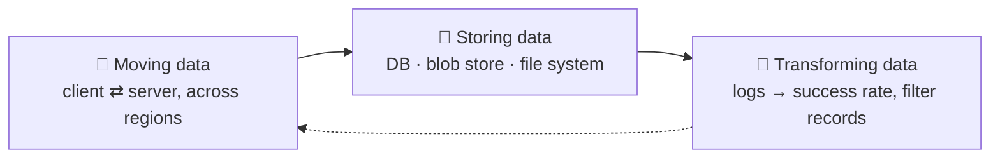
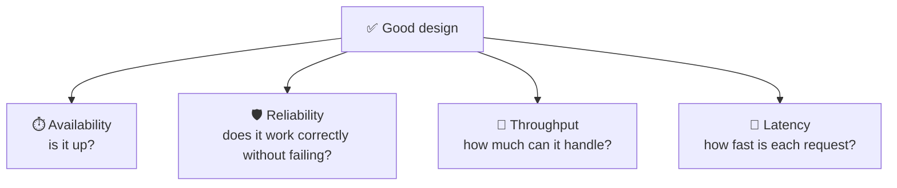
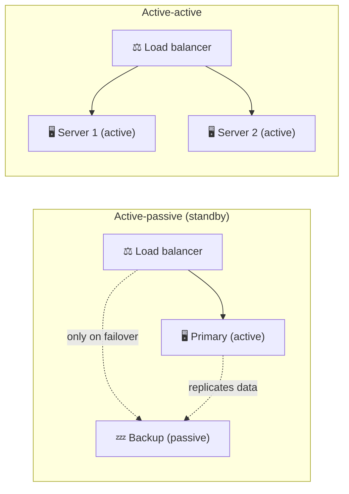
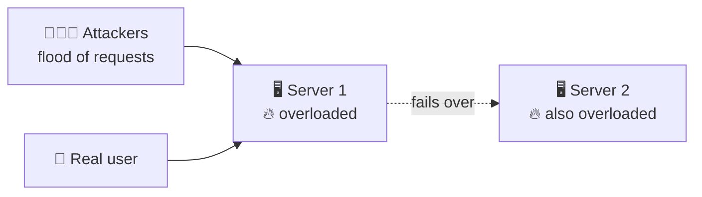
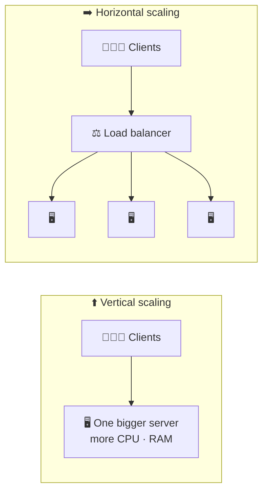
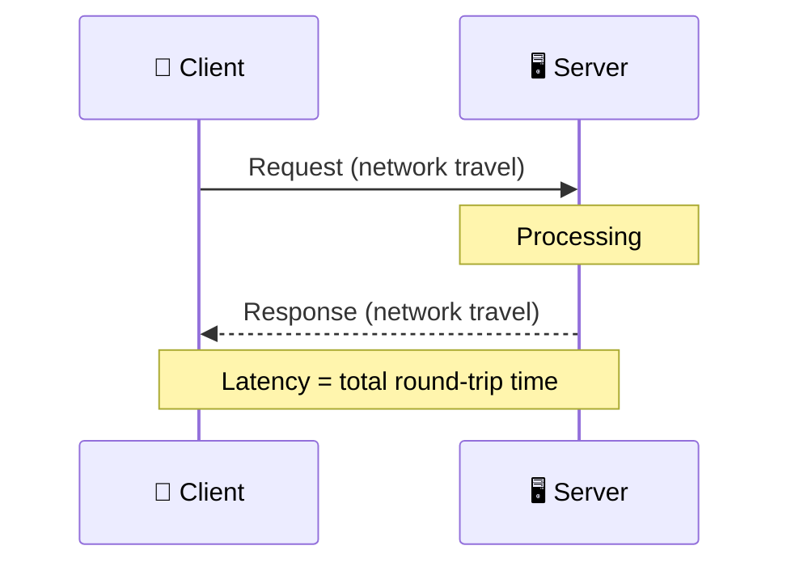

# 📐 Design Requirements

> [!abstract] 一句话总结 One-line summary
> 任何大型系统归根结底都是在**移动、存储和转换数据**，好的设计用**可用性、可靠性、吞吐量和延迟**来衡量。面试不太在意每个组件的内部细节，更在意你如何**推理权衡**。
> Every large system boils down to **moving, storing, and transforming data**, and a good design is judged by **availability, reliability, throughput, and latency**. Interviews care less about every component's internals and more about how you **reason through trade-offs**.

## 1. 太长不看 TL;DR

- 🧠 **面试心态 Interview mindset:** 不需要知道每个细节。要清楚自己往哪个方向走，并能**比较不同选择的权衡**。
  You don't need every detail. Know where you're heading and be able to **compare trade-offs** between choices.
- 🚚 **移动数据 Moving data:** 在客户端和服务器之间移动，常常跨越全球。比在一台计算机内部移动数据难得多。
  Between clients and servers, often across the world. Much harder than moving data inside one computer.
- 💾 **存储数据 Storing data:** 数据库、blob 存储、文件系统还是分布式文件系统？就像选数据结构一样，取决于使用场景。
  Database, blob store, file system, distributed file system? Like picking a data structure, it depends on the use case.
- 🔄 **转换数据 Transforming data:** 把原始数据变成有用的东西，比如把服务器日志变成成功率和失败率。
  Turn raw data into something useful, such as server logs into a success/failure rate.
- ⏱️ **可用性 Availability:** 系统正常运行的时间比例，用“几个 9”来衡量（99.9%、99.99%……）。在 **SLA** 中承诺，用 **SLO** 作为目标。
  The percentage of time the system is up, measured in "nines" (99.9%, 99.99%, …). Promised in **SLAs**, targeted with **SLOs**.
- 🛡️ **可靠性与容错 Reliability & fault tolerance:** 部分组件出故障时仍能继续工作。靠**冗余**实现。
  Keep working when parts fail. Achieved through **redundancy**.
- 🚀 **吞吐量 Throughput:** 单位时间内完成的工作量（请求/秒、查询/秒、字节/秒）。
  How much work per unit of time (requests/s, queries/s, bytes/s).
- 🐢 **延迟 Latency:** 一个请求从发出到收到响应要多久。
  How long one request takes, from request to response.

## 2. 🧭 用系统设计的方式思考 Thinking in System Design

任何大系统都可以拆成三项工作：
Any big system can be broken down into three jobs:

| | 🚚 移动数据 Moving data | 💾 存储数据 Storing data | 🔄 转换数据 Transforming data |
| --- | --- | --- | --- |
| 一台计算机内部 Inside one computer | 磁盘 ⇄ 内存 ⇄ CPU 处理器 Disk ⇄ RAM ⇄ CPU (see [[Computer Architecture]]) | 内存（快、易失）vs 磁盘（慢、持久） RAM (fast, volatile) vs disk (slow, persistent) | CPU 运行你的算法 CPU runs your algorithm |
| 分布式系统中 In a distributed system | 客户端 ⇄ 服务器，可能在不同大洲 Clients ⇄ servers, possibly on different continents | 数据库、blob 存储（如 S3）、文件系统、分布式文件系统 Databases, blob stores (e.g. S3), file systems, distributed file systems | 数据管道、批处理任务、监控服务 Pipelines, batch jobs, monitoring services |
| 关键问题 Key question | 怎样通过网络又快又可靠地移动数据？ How do we move it fast and reliably over the network? | 哪种存储适合*这种*访问模式？ Which storage fits *this* access pattern? | 处理它最高效的方式是什么？ What's the most efficient way to process it? |

> [!example] 转换数据的例子 Transforming data
> - 服务器日志 → **成功请求和失败请求的百分比**（通常由监控服务完成）。
>   Server logs → **% of successful requests vs % of failed requests** (often done by a monitoring service).
> - 病历 → **按年龄筛选的病人**。
>   Medical records → **patients filtered by age**.

> [!tip] Java 类比：选存储就像选集合类 Java analogy: storage is like choosing a collection
> `ArrayList` 并不比 `TreeMap`“更好”，它们各自适合不同的访问模式。同样，关系型数据库也不总是比 blob 存储好。选适合工作负载的那个。
> `ArrayList` isn't "better" than `TreeMap`; each wins for a different access pattern. In the same way, a relational database isn't always better than a blob store. Pick the one that fits the workload.

> [!important] 为什么设计选择这么重要 Why design choices matter so much
> 烂算法修起来很便宜：重写方法、重新部署就行。烂的**架构**选择代价很高。选错数据库可能意味着要把**所有数据迁移**到新数据库，*还要*重写部分应用，而且通常要在系统不停机的情况下做。
> A bad algorithm is cheap to fix: rewrite the method and redeploy. A bad **architecture** choice is expensive. Picking the wrong database can mean **migrating all the data** to a new one *and* rewriting parts of the application, often while the system stays live.

## 3. ✅ 什么是好的设计？ What Is Good Design?

好的设计用几个标准属性来衡量。它们是你**比较权衡**时用的词汇。
Good design is measured with a few standard properties. They are the vocabulary you use to **compare trade-offs**.

## 4. ⏱️ 可用性 Availability

**可用性**是在一段时间内，系统正常运行并处理请求的时间所占的百分比。
**Availability** is the percentage of time a system is up and serving requests over a given period.

$$
\text{availability} = \frac{\text{uptime}}{\text{uptime} + \text{downtime}}
$$

- 过去，很多系统只需要在工作时间（周一到周五，朝九晚五）可用。
  In the past, many systems only needed to be up during business hours (Mon–Fri, 9 to 5).
- 如今用户遍布全球，任何时间都在用，所以我们的目标是**接近 24/7** 运行。
  Today, users are global and use systems at any hour, so we aim for **near 24/7** operation.

### 4.1 🔧 计划内与计划外停机 Planned vs unplanned downtime

| | 📅 计划内 Planned | 💥 计划外 Unplanned |
| --- | --- | --- |
| 例子 Examples | 软件更新、维护、验证、备份 Software updates, maintenance, verification, backups | 硬件或软件故障、网络中断、自然灾害 Hardware or software failures, network outages, natural disasters |
| 可预测吗？ Predictable? | 可以，能安排在低峰时段（或用滚动部署避免） Yes, can be scheduled for quiet hours (or avoided with rolling deploys) | 不能，但可以降低它发生的可能性和影响 No, but its likelihood and impact can be reduced |

> [!example] 一天只停机一小时 23 hours out of 24
> $\frac{23}{23 + 1} \approx 95.8\%$。听起来很高，但意味着**每天有一小时**在流失用户和收入。对真实产品来说非常差。
> $\frac{23}{23 + 1} \approx 95.8\%$. That sounds high, but it means losing users and money for **an hour every day**. Very poor for a real product.

### 4.2 🔢 “几个 9” The "nines"

100% 是不可能的，因为计划外停机总会发生，所以可用性用**几个 9** 来描述。每多一个 9，允许的停机时间就缩小 **10 倍**。
100% is impossible because unplanned downtime always happens, so availability is described in **nines**. Each extra nine cuts the allowed downtime by **10×**.

| 可用性 Availability | 几个 9 Nines | 每年停机 Downtime per year | 每月停机（约 30 天） Downtime per month (≈30 days) |
| --- | --- | --- | --- |
| 99% | 两个 9 Two nines | ≈ 3.65 天 days | ≈ 7.2 小时 hours |
| 99.9% | 三个 9 Three nines | ≈ 8.77 小时 hours | ≈ 43 分钟 minutes |
| 99.99% | 四个 9 Four nines | ≈ 52.6 分钟 minutes | ≈ 4.3 分钟 minutes |
| 99.999% | 五个 9 Five nines | ≈ 5.26 分钟 minutes | ≈ 26 秒 seconds |

> [!tip] 快速计算 Quick math
> 一年约 525,600 分钟。停机时间 = (1 − 可用性) × 总时间。对 99.999%：$0.00001 \times 525{,}600 \approx 5.26$ 分钟。
> One year ≈ 525,600 minutes. Downtime = (1 − availability) × total time. For 99.999%: $0.00001 \times 525{,}600 \approx 5.26$ minutes.

> [!important] 五个 9 是给关键任务系统的 Five nines is for mission-critical systems
> 99.999% 很难达到（而且很贵）。它适合支付、紧急服务这类系统，而不是每个内部工具。每多一个 9，都要付出更多冗余、自动化和运维工作。
> 99.999% is very hard (and expensive) to reach. It makes sense for things like payments or emergency services, not for every internal tool. Each extra nine costs more redundancy, automation, and operations work.

### 4.3 📜 三个服务水平术语 SLA vs SLO (and SLI)

| | 📏 SLI | 🎯 SLO | 🤝 SLA |
| --- | --- | --- | --- |
| 全称 Full name | 服务水平**指标** Service Level **Indicator** | 服务水平**目标** Service Level **Objective** | 服务水平**协议** Service Level **Agreement** |
| 是什么 What it is | 实际的测量值 The actual measurement | 团队内部追求的目标 The internal target the team aims for | 对客户的承诺，违约有后果 The promise made to customers, with consequences |
| 例子 Example | “本月 99.95% 的请求成功” "99.95% of requests succeeded this month" | “每月成功率达到 99.95% 以上” "Success rate ≥ 99.95% each month" | “每月可用性不低于 99.9%，否则返还服务抵扣金” "Monthly uptime ≥ 99.9%, or you get service credits back" |
| 受众 Audience | 工程师 Engineers | 工程团队 Engineering team | 客户（这是合同） Customers (it's a contract) |

> [!example] 云服务商的可用性承诺 Cloud SLAs
> 云服务商为每项服务公布 SLA。例如 AWS 为跨多个可用区的 EC2 提供 **99.99%** 的月度可用性。没达到时，客户会按比例拿回**服务抵扣金**。
> Cloud providers publish an SLA per service. For example, AWS offers **99.99%** monthly uptime for EC2 across multiple Availability Zones. If it misses that, customers get a percentage back as **service credits**.

> [!note] SLO 通常比 SLA 更严格 SLO is usually stricter than SLA
> 团队把 SLO 定得比 SLA 高（例如 SLO 99.95%，SLA 99.9%），这样在违约*之前*就能收到警告并做出反应。
> Teams set the SLO above the SLA (e.g. SLO 99.95%, SLA 99.9%) so they get warned and can react *before* they break the contract.

## 5. 🛡️ 可靠性、容错和冗余 Reliability, Fault Tolerance, and Redundancy

| 术语 Term | 回答的问题 Question it answers | 一句话 In one line |
| --- | --- | --- |
| 🛡️ **可靠性** Reliability | 它能长期正确工作吗？ Will it keep working correctly over time? | 系统在一段时间内**不出故障**地完成功能的概率。 The probability the system performs its function **without failure** for a given period. |
| 🩹 **容错** Fault tolerance | 某个部分坏了会怎样？ What happens when a part breaks? | 组件故障时系统**继续运行**（可能降级）：关闭某个功能、切换模式，或故障转移到另一台服务器。 The system **keeps running** (maybe degraded) when a component fails: disable a feature, switch modes, or fail over to another server. |
| 👯 **冗余** Redundancy | 怎样实现容错？ How do we get fault tolerance? | **复制**关键组件，消除单点故障。 **Duplicate** critical components so there's no single point of failure. |

> [!note] 可用 ≠ 可靠 Available ≠ reliable
> 服务器可能是**可用**的（它会响应），但不**可靠**（返回错误，或者几千个用户一来就崩溃）。可靠性问的是：它有多大可能出故障，在高负载下有多容易挂掉？
> A server can be **available** (it answers) but not **reliable** (it returns errors, or crashes as soon as thousands of users show up). Reliability asks: how likely is it to fail, and how easily does it go down under heavy load?

### 5.1 👯 主备与双活 Active-passive vs active-active

| | 💤 主备 Active-passive | ⚡ 双活 Active-active |
| --- | --- | --- |
| 工作方式 How it works | 备机“跟随”主机，只在主机故障时接管 A backup "shadows" the primary and takes over only if it fails | 所有服务器同时处理流量 All servers handle traffic at the same time |
| 平时的容量 Normal capacity | 只有主机在干活；备机闲着 Only the primary does work; the backup sits idle | 所有服务器分担负载 All servers share the load |
| 故障时 On failure | **故障转移**：切到备机（可能需要一点时间） **Failover**: switch to the backup (may take a moment) | 其余服务器接住流量 Remaining servers absorb the traffic |
| 权衡 Trade-off | 更简单，尤其适合数据库（只有一个写入者） Simpler, especially for databases (one writer) | 硬件利用率更高，但服务器之间要协调（状态、一致性） Better use of hardware, but servers must coordinate (state, consistency) |

### 5.2 ⚠️ 冗余不是万能药：DDoS 的例子 Redundancy is not a cure-all: the DDoS example

在 **DDoS（分布式拒绝服务）** 攻击中，大量来自许多机器（**僵尸网络**）的恶意请求淹没服务器。真实用户的请求被堵在后面，只有少数能得到响应。
In a **DDoS (Distributed Denial of Service)** attack, huge volumes of malicious requests from many machines (a **botnet**) flood the server. Real users' requests get stuck behind them, and only a few get responses.

第二台服务器能顶一阵，但攻击也会把它压垮。真正的 DDoS 防御需要的不只是冗余：还要**限流**、**CDN** 和流量过滤服务（如 AWS Shield、Cloudflare）。
A second server helps for a while, but the attack can overload it too. Real DDoS defense needs more than redundancy: **rate limiting**, **CDNs**, and traffic-filtering services (e.g. AWS Shield, Cloudflare).

## 6. 🚀 吞吐量 Throughput

**吞吐量**是系统在单位时间内处理的工作量。
**Throughput** is the amount of work a system handles per unit of time.

| 单位 Unit | 衡量什么 Measures | 最适合… Fits best when… |
| --- | --- | --- |
| **每秒请求数** Requests/second (RPS) | 服务器处理的请求数 Requests a server handles | 客户端 ⇄ 服务器的流量 Client ⇄ server traffic |
| **每秒查询数** Queries/second (QPS) | 对服务器或数据库的查询数 Queries to a server or database | 围绕用户和他们的操作做设计 Designing around users and their actions |
| **每秒字节数** Bytes/second | 处理或传输的数据量 Data processed or transferred | 数据管道（如转换大数据集），数据不属于某个用户 Data pipelines (e.g. converting large datasets), where data isn't tied to one user |

### 6.1 📈 提高吞吐量 Increasing throughput

- ⬆️ **垂直扩展 Vertical scaling:** 一台服务器因为更强而能处理更多请求。简单，但有硬上限。
  One server handles more requests because it is more powerful. Simple, but has a hard ceiling.
- ➡️ **水平扩展 Horizontal scaling:** 更多服务器分担请求，能扩展得远得多（详见 [[Application Architecture|应用架构 Application Architecture]]）。
  More servers share the requests. Scales much further. (Details in [[Application Architecture|应用架构 Application Architecture]].)

## 7. 🐢 延迟 Latency

**延迟**是客户端发出请求到收到响应之间的时间：也就是**往返**时间。
**Latency** is the delay between a client making a request and getting the response: the **round trip** time.

> [!note] 单程与往返 One-way vs round trip
> “延迟”有时指单程的网络延迟。用户感受到的响应时间是完整的往返：双向的网络传输**加上**服务器处理时间。
> "Latency" sometimes means one-way network delay. The response time a user feels is the full round trip: network travel both ways **plus** server processing time.

| | 🚀 吞吐量 Throughput | 🐢 延迟 Latency |
| --- | --- | --- |
| 问题 Question | 每秒能处理**多少**个？ How **many** per second? | **一个**要花**多久**？ How **long** does **one** take? |
| 单位 Unit | 请求/秒、QPS、字节/秒 Requests/s, QPS, bytes/s | 毫秒 Milliseconds |
| 类比 Analogy | 每小时有多少辆车通过高速公路 How many cars cross a highway per hour | 一辆车从 A 到 B 要多久 How long one car takes to get from A to B |
| 提升方式 Improved by | 扩展、并行 Scaling, parallelism | 缓存、CDN、离用户更近的服务器、更快的代码 Caching, CDNs, servers closer to users, faster code |

> [!note] 延迟无处不在 Latency exists everywhere
> 它不只是网络的事。在计算机内部，**CPU** 从缓存、内存或磁盘读数据时也要等，而且每一级都比上一级慢（见 [[Computer Architecture|计算机架构 Computer Architecture]]）。
> It isn't only a network thing. Inside a computer, the **CPU** waits when it reads from cache, RAM, or disk, and each level is slower than the one before (see [[Computer Architecture|计算机架构 Computer Architecture]]).

> [!tip] 吞吐量和延迟相关但不同 Throughput and latency are related but different
> 加服务器可以提高吞吐量，但不会让任何单个请求变快。一个系统可以**同时有高吞吐量和高延迟**（例如批处理管道）。
> Adding servers can raise throughput without making any single request faster. A system can have **high throughput and high latency** at the same time (e.g. a batch pipeline).

## 8. 🎯 小结 Closing Notes

我们想要的系统能**处理故障**，有**高可用性**、**高吞吐量**和**低延迟**。接下来的课程会深入讲影响这些属性的因素，以及如何为它们做设计。
We want systems that **handle failures**, have **high availability**, **high throughput**, and **low latency**. The next lessons go deeper into what affects each of these and how to design for them.

## 9. ⚠️ 对课程原文的澄清 Clarifications to the Lesson Text

- **“24 小时可用 23 小时 = 96%” "Uptime of 23 out of 24 hours = 96%":** 是 95.8%，四舍五入为 96%。结论不变：每天停机一小时很糟糕。
  It's 95.8%, rounded to 96%. The point stands: an hour of downtime a day is bad.
- **“99.999% = 每年停机 5 分钟” "99.999% = 5 minutes of downtime per year":** 更准确地说约 **5.26 分钟**。差不多，但面试时值得知道准确数字。
  More precisely about **5.26 minutes**. Close enough, but worth knowing the exact figure for interviews.
- **“AWS 的月度 SLA 是 99.99%” "AWS's monthly SLA is 99.99%":** AWS 没有统一的 SLA，每项服务各有各的。例如 EC2 在区域级别（多个可用区）是 99.99%，单个实例只有 99.5%；S3 Standard 是 99.9%。
  AWS doesn't have a single SLA. Each service has its own, e.g. EC2 offers 99.99% at region level (multiple AZs) but only 99.5% for a single instance, while S3 Standard offers 99.9%.
- **SLO 与 SLA 的关系 SLO vs SLA:** 课程把 SLO 描述为“为了满足 SLA”所需的目标。实际中 SLO 是比 SLA **更严格**的内部目标，而且还有第三个术语 **SLI**，即实际测量值。
  The lesson describes the SLO as the objective needed "to meet the SLA". In practice the SLO is an internal target set **stricter** than the SLA, and there's a third term, the **SLI**, the actual measured value.
- **“容错是系统检测并自我修复的能力” "Fault tolerance is how well the system can detect and heal itself":** 容错是指系统**在故障下继续运行**。检测和恢复（自愈）相关，但是另一回事。
  Fault tolerance means the system **keeps operating despite a failure**. Detecting and recovering (self-healing) is related but separate.
- **“冗余指不必要的东西” "Redundancy refers to something unessential":** 在工程中，冗余是**有意复制关键组件**，以消除单点故障。备用件平时用不上，但出故障时必不可少。
  In engineering, redundancy means **deliberately duplicating critical components** so there's no single point of failure. The spare isn't needed day-to-day, but it's essential when something breaks.
- **“大多数情况下冗余指双活” "In most cases, redundancy means active-active":** 两种都很常见。无状态的应用服务器通常是双活；数据库常常是主备（一个主库、几个备用副本），因为多个写入者很难保持一致。
  Both are common. Stateless app servers are usually active-active; databases are often active-passive (one primary, standby replicas), because multiple writers are hard to keep consistent.
- **冗余挡不住攻击 Redundancy and DDoS:** 课程正确指出冗余不是完美的解决办法。单靠冗余防不了 DDoS，需要限流、CDN 和流量过滤。
  The lesson correctly says redundancy isn't a perfect fix. Redundancy alone is not a DDoS defense; that needs rate limiting, CDNs, and traffic filtering.
- **“字节/秒是网络能发送的最大数据量” "Bytes/second is the maximum amount of data that can be sent over a network":** 那个最大值是**带宽**（容量）。吞吐量是实际达到的速率，最多等于带宽。
  That maximum is **bandwidth** (capacity). Throughput is the rate actually achieved, which is at most the bandwidth.
- **“吞吐量是每秒能通过网络发送多少请求” "Throughput is how many requests can be sent over a network per second":** 吞吐量是系统每秒实际**处理**了多少，而不只是发送了多少。
  Throughput is how many the system actually **handles** per second, not just sends.
- **“内存和缓存向 CPU 发请求” "The RAM and the cache making requests from the CPU":** 正好相反：是 **CPU** 向缓存和内存请求数据。
  It's the other way around: the **CPU** requests data from the cache and RAM.
- **好的设计还有更多维度 Good design has more dimensions:** 除了这里讲的四个，面试还会讨论**可扩展性**、**一致性**、**可维护性**和**成本**。
  Beyond the four covered here, interviews also discuss **scalability**, **consistency**, **maintainability**, and **cost**.

## 10. 🧩 复习题 Review Questions

**Q1.** 任何大型系统都可以归结为哪三件事？ What three things does any large system boil down to?

> [!success]- 答案 Answer
> 移动数据（在客户端和服务器之间，常常跨区域）、存储数据（数据库、blob 存储、文件系统）和转换数据（把原始数据变成有用的东西）。
> Moving data (between clients and servers, often across regions), storing data (databases, blob stores, file systems), and transforming data (turning raw data into something useful).

**Q2.** 为什么烂的架构选择比烂算法代价更大？ Why is a bad architecture choice more costly than a bad algorithm?

> [!success]- 答案 Answer
> 烂算法可以重写、重新部署，影响很小。烂的架构选择，比如选错数据库，可能需要迁移所有数据并重写部分应用，而且通常要在系统运行时进行。
> A bad algorithm can be rewritten and redeployed with little impact. A bad architecture choice, such as the wrong database, can require migrating all the data and rewriting parts of the application, often while the system is live.

**Q3.** 可用性怎么计算？ How is availability calculated?

> [!success]- 答案 Answer
> 在一段时间内，可用性 = 正常运行时间 / (正常运行时间 + 停机时间)。
> availability = uptime / (uptime + downtime), over a given period.

**Q4.** 可用性 99.9% 和 99.999% 每年大约允许多少停机时间？ Roughly how much downtime per year do 99.9% and 99.999% allow?

> [!success]- 答案 Answer
> 99.9% ≈ 每年 8.77 小时。99.999% ≈ 每年 5.26 分钟。每多一个 9，停机时间缩小 10 倍。
> 99.9% ≈ 8.77 hours per year. 99.999% ≈ 5.26 minutes per year. Each extra nine cuts downtime by 10×.

**Q5.** SLA、SLO 和 SLI 有什么区别？ What's the difference between an SLA, an SLO, and an SLI?

> [!success]- 答案 Answer
> SLI 是实际测量值（如测得的可用性）。SLO 是团队的内部目标。SLA 是和客户的合同，没达到会有惩罚，比如服务抵扣金。SLO 通常比 SLA 更严格。
> The SLI is the actual measurement (e.g. measured uptime). The SLO is the team's internal target. The SLA is the contract with customers, with penalties such as service credits if it's missed. The SLO is usually stricter than the SLA.

**Q6.** 可用性和可靠性有什么区别？ What's the difference between availability and reliability?

> [!success]- 答案 Answer
> 可用性是系统正常运行的时间比例。可靠性是它在一段时间内正确工作、不出故障的概率。系统可能会响应（可用），却返回错误或在负载下崩溃（不可靠）。
> Availability is the fraction of time the system is up. Reliability is the probability that it works correctly without failing over a period. A system can respond (available) yet return errors or crash under load (unreliable).

**Q7.** 冗余如何带来容错？主备和双活有什么区别？ How does redundancy give fault tolerance? What's active-passive vs active-active?

> [!success]- 答案 Answer
> 复制关键组件消除了单点故障，所以一个坏了系统还能继续运行。主备：备机只在故障时接管。双活：所有副本同时处理流量，一个坏了其余的接住负载。
> Duplicating critical components removes single points of failure, so the system keeps running when one fails. Active-passive: a standby takes over only on failure. Active-active: all copies serve traffic at the same time and the rest absorb the load if one fails.

**Q8.** 为什么一台备用服务器不足以扛住 DDoS 攻击？ Why isn't a backup server enough to survive a DDoS attack?

> [!success]- 答案 Answer
> 大量恶意流量也会把备机压垮。DDoS 防御需要限流、CDN 和流量过滤，而不只是更多服务器。
> The flood of malicious traffic will overload the backup too. DDoS defense needs rate limiting, CDNs, and traffic filtering, not just more servers.

**Q9.** 什么时候用 QPS 衡量吞吐量，什么时候用字节/秒？ When would you measure throughput in QPS vs bytes/second?

> [!success]- 答案 Answer
> 工作由用户发起请求驱动时用 QPS。处理大量不属于某个用户的数据的数据管道，用字节/秒。
> QPS when the work is driven by users making requests. Bytes/second for data pipelines that process large volumes of data not tied to individual users.

**Q10.** 吞吐量和延迟有什么区别？ What's the difference between throughput and latency?

> [!success]- 答案 Answer
> 吞吐量是系统单位时间内处理的操作数。延迟是单个请求的往返时间。水平扩展可以提高吞吐量，但不一定降低延迟。
> Throughput is how many operations the system handles per unit of time. Latency is how long a single request takes, round trip. Scaling out can raise throughput without lowering latency.

## 11. 🔗 相关 Related

- ⬅️ 上一篇 Previous: [[Application Architecture|应用架构 Application Architecture]]
- [[Computer Architecture|计算机架构 Computer Architecture]]
- [[📌 系统设计总览|系统设计总览 System Design Overview]]
