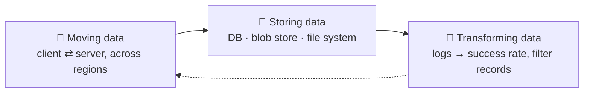
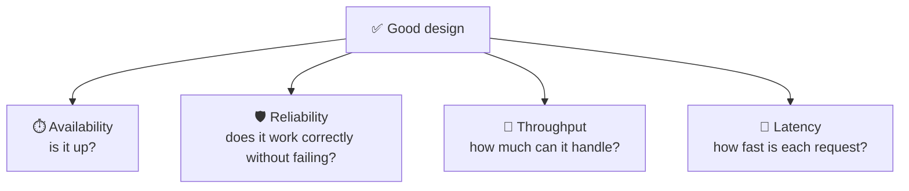
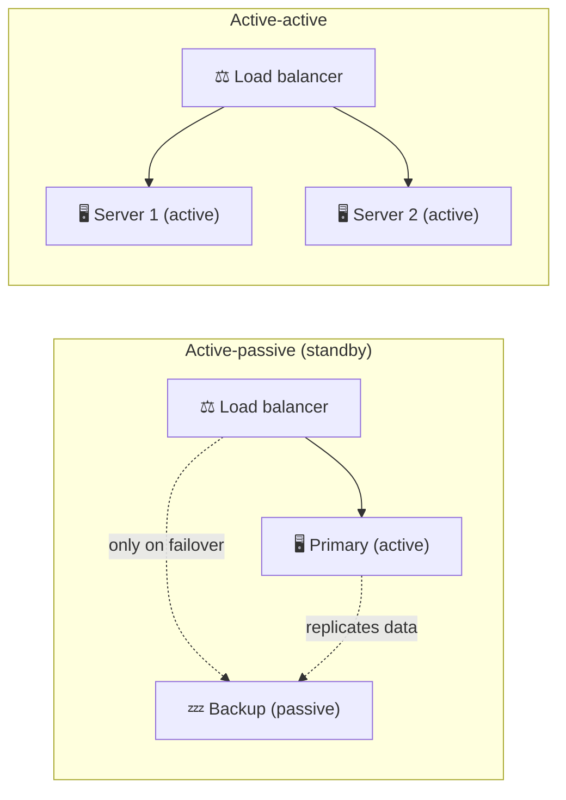
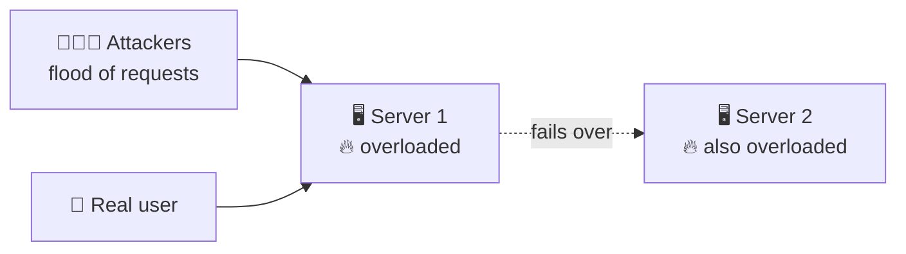
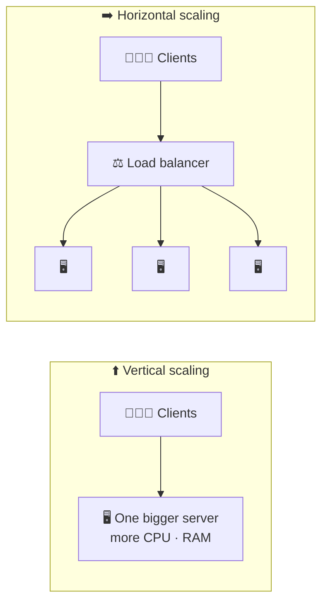
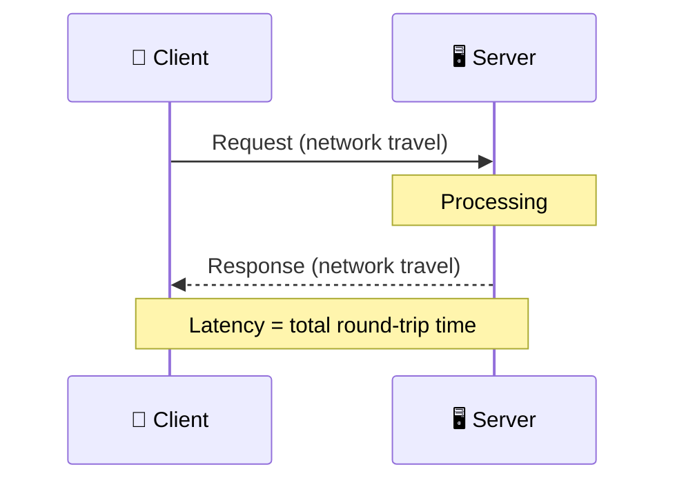

# 📐 Design Requirements

> [!abstract] One-line summary
> Every large system boils down to **moving, storing, and transforming data**, and a good design is judged by **availability, reliability, throughput, and latency**. Interviews care less about every component's internals and more about how you **reason through trade-offs**.

## 1. TL;DR

- 🧠 **Interview mindset**: you don't need every detail. Know where you're heading and be able to **compare trade-offs** between choices.
- 🚚 **Moving data**: between clients and servers, often across the world. Much harder than moving data inside one computer.
- 💾 **Storing data**: database, blob store, file system, distributed file system? Like picking a data structure, it depends on the use case.
- 🔄 **Transforming data**: turn raw data into something useful, such as server logs into a success/failure rate.
- ⏱️ **Availability**: the percentage of time the system is up, measured in "nines" (99.9%, 99.99%, …). Promised in **SLAs**, targeted with **SLOs**.
- 🛡️ **Reliability & fault tolerance**: keep working when parts fail. Achieved through **redundancy**.
- 🚀 **Throughput**: how much work per unit of time (requests/s, queries/s, bytes/s).
- 🐢 **Latency**: how long one request takes, from request to response.

## 2. 🧭 Thinking in System Design

Any big system can be broken down into three jobs:

| | 🚚 Moving data | 💾 Storing data | 🔄 Transforming data |
| --- | --- | --- | --- |
| Inside one computer | Disk ⇄ RAM ⇄ CPU (see [[Computer Architecture]]) | RAM (fast, volatile) vs disk (slow, persistent) | CPU runs your algorithm |
| In a distributed system | Clients ⇄ servers, possibly on different continents | Databases, blob stores (e.g. S3), file systems, distributed file systems | Pipelines, batch jobs, monitoring services |
| Key question | How do we move it fast and reliably over the network? | Which storage fits *this* access pattern? | What's the most efficient way to process it? |

> [!example] Transforming data
> - Server logs → **% of successful requests vs % of failed requests** (often done by a monitoring service).
> - Medical records → **patients filtered by age**.

> [!tip] Java analogy: storage is like choosing a collection
> `ArrayList` isn't "better" than `TreeMap`; each wins for a different access pattern. In the same way, a relational database isn't always better than a blob store. Pick the one that fits the workload.

> [!important] Why design choices matter so much
> A bad algorithm is cheap to fix: rewrite the method and redeploy. A bad **architecture** choice is expensive. Picking the wrong database can mean **migrating all the data** to a new one *and* rewriting parts of the application, often while the system stays live.

## 3. ✅ What Is Good Design?

Good design is measured with a few standard properties. They are the vocabulary you use to **compare trade-offs**.

## 4. ⏱️ Availability

**Availability** is the percentage of time a system is up and serving requests over a given period.

$$
\text{availability} = \frac{\text{uptime}}{\text{uptime} + \text{downtime}}
$$

- In the past, many systems only needed to be up during business hours (Mon–Fri, 9 to 5).
- Today, users are global and use systems at any hour, so we aim for **near 24/7** operation.

### 4.1 🔧 Planned vs unplanned downtime

| | 📅 Planned | 💥 Unplanned |
| --- | --- | --- |
| Examples | Software updates, maintenance, verification, backups | Hardware or software failures, network outages, natural disasters |
| Predictable? | Yes, can be scheduled for quiet hours (or avoided with rolling deploys) | No, but its likelihood and impact can be reduced |

> [!example] 23 hours out of 24
> $\frac{23}{23 + 1} \approx 95.8\%$. That sounds high, but it means losing users and money for **an hour every day**. Very poor for a real product.

### 4.2 🔢 The "nines"

100% is impossible because unplanned downtime always happens, so availability is described in **nines**. Each extra nine cuts the allowed downtime by **10×**.

| Availability | Nines | Downtime per year | Downtime per month (≈30 days) |
| --- | --- | --- | --- |
| 99% | two nines | ≈ 3.65 days | ≈ 7.2 hours |
| 99.9% | three nines | ≈ 8.77 hours | ≈ 43 minutes |
| 99.99% | four nines | ≈ 52.6 minutes | ≈ 4.3 minutes |
| 99.999% | five nines | ≈ 5.26 minutes | ≈ 26 seconds |

> [!tip] Quick math
> One year ≈ 525,600 minutes. Downtime = (1 − availability) × total time. For 99.999%: $0.00001 \times 525{,}600 \approx 5.26$ minutes.

> [!important] Five nines is for mission-critical systems
> 99.999% is very hard (and expensive) to reach. It makes sense for things like payments or emergency services, not for every internal tool. Each extra nine costs more redundancy, automation, and operations work.

### 4.3 📜 SLA vs SLO (and SLI)

| | 📏 SLI | 🎯 SLO | 🤝 SLA |
| --- | --- | --- | --- |
| Full name | Service Level **Indicator** | Service Level **Objective** | Service Level **Agreement** |
| What it is | The actual measurement | The internal target the team aims for | The promise made to customers, with consequences |
| Example | "99.95% of requests succeeded this month" | "≥ 99.95% success rate per month" | "≥ 99.9% monthly uptime, or you get service credits back" |
| Audience | Engineers | Engineering team | Customers (it's a contract) |

> [!example] Cloud SLAs
> Cloud providers publish an SLA per service. For example, AWS offers **99.99%** monthly uptime for EC2 across multiple Availability Zones. If it misses that, customers get a percentage back as **service credits**.

> [!note] SLO is usually stricter than SLA
> Teams set the SLO above the SLA (e.g. SLO 99.95%, SLA 99.9%) so they get warned and can react *before* they break the contract.

## 5. 🛡️ Reliability, Fault Tolerance, and Redundancy

| Term | Question it answers | In one line |
| --- | --- | --- |
| 🛡️ **Reliability** | Will it keep working correctly over time? | The probability the system performs its function **without failure** for a given period. |
| 🩹 **Fault tolerance** | What happens when a part breaks? | The system **keeps running** (maybe degraded) when a component fails: disable a feature, switch modes, or fail over to another server. |
| 👯 **Redundancy** | How do we get fault tolerance? | **Duplicate** critical components so there's no single point of failure. |

> [!note] Available ≠ reliable
> A server can be **available** (it answers) but not **reliable** (it returns errors, or crashes as soon as thousands of users show up). Reliability asks: how likely is it to fail, and how easily does it go down under heavy load?

### 5.1 👯 Active-passive vs active-active

| | 💤 Active-passive | ⚡ Active-active |
| --- | --- | --- |
| How it works | A backup "shadows" the primary and takes over only if it fails | All servers handle traffic at the same time |
| Normal capacity | Only the primary does work; the backup sits idle | All servers share the load |
| On failure | **Failover**: switch to the backup (may take a moment) | Remaining servers absorb the traffic |
| Trade-off | Simpler, especially for databases (one writer) | Better use of hardware, but servers must coordinate (state, consistency) |

### 5.2 ⚠️ Redundancy is not a cure-all: the DDoS example

In a **DDoS (Distributed Denial of Service)** attack, huge volumes of malicious requests from many machines (a **botnet**) flood the server. Real users' requests get stuck behind them, and only a few get responses.

A second server helps for a while, but the attack can overload it too. Real DDoS defense needs more than redundancy: **rate limiting**, **CDNs**, and traffic-filtering services (e.g. AWS Shield, Cloudflare).

## 6. 🚀 Throughput

**Throughput** is the amount of work a system handles per unit of time.

| Unit | Measures | Fits best when… |
| --- | --- | --- |
| **Requests/second** (RPS) | Requests a server handles | Client ⇄ server traffic |
| **Queries/second** (QPS) | Queries to a server or database | Designing around users and their actions |
| **Bytes/second** | Data processed or transferred | Data pipelines (e.g. converting large datasets), where data isn't tied to one user |

### 6.1 📈 Increasing throughput

- ⬆️ **Vertical scaling**: one server handles more requests because it is more powerful. Simple, but has a hard ceiling.
- ➡️ **Horizontal scaling**: more servers share the requests. Scales much further. (Details in [[Application Architecture]].)

## 7. 🐢 Latency

**Latency** is the delay between a client making a request and getting the response: the **round trip** time.

> [!note] One-way vs round trip
> "Latency" sometimes means one-way network delay. The response time a user feels is the full round trip: network travel both ways **plus** server processing time.

| | 🚀 Throughput | 🐢 Latency |
| --- | --- | --- |
| Question | How **many** per second? | How **long** does **one** take? |
| Unit | Requests/s, QPS, bytes/s | Milliseconds |
| Analogy | How many cars cross a highway per hour | How long one car takes to get from A to B |
| Improved by | Scaling, parallelism | Caching, CDNs, servers closer to users, faster code |

> [!note] Latency exists everywhere
> It isn't only a network thing. Inside a computer, the **CPU** waits when it reads from cache, RAM, or disk, and each level is slower than the one before (see [[Computer Architecture]]).

> [!tip] Throughput and latency are related but different
> Adding servers can raise throughput without making any single request faster. A system can have **high throughput and high latency** at the same time (e.g. a batch pipeline).

## 8. 🎯 Closing Notes

We want systems that **handle failures**, have **high availability**, **high throughput**, and **low latency**. The next lessons go deeper into what affects each of these and how to design for them.

## 9. ⚠️ Clarifications to the Lesson Text

- **"Uptime of 23 out of 24 hours = 96%."** It's 95.8%, rounded to 96%. The point stands: an hour of downtime a day is bad.
- **"99.999% = 5 minutes of downtime per year."** More precisely about **5.26 minutes**. Close enough, but worth knowing the exact figure for interviews.
- **"AWS's monthly SLA is 99.99%."** AWS doesn't have a single SLA. Each service has its own, e.g. EC2 offers 99.99% at region level (multiple AZs) but only 99.5% for a single instance, while S3 Standard offers 99.9%.
- **SLO vs SLA.** The lesson describes the SLO as the objective needed "to meet the SLA". In practice the SLO is an internal target set **stricter** than the SLA, and there's a third term, the **SLI**, the actual measured value.
- **"Fault tolerance is how well the system can detect and heal itself."** Fault tolerance means the system **keeps operating despite a failure**. Detecting and recovering (self-healing) is related but separate.
- **"Redundancy refers to something unessential."** In engineering, redundancy means **deliberately duplicating critical components** so there's no single point of failure. The spare isn't needed day-to-day, but it's essential when something breaks.
- **"In most cases, redundancy means active-active."** Both are common. Stateless app servers are usually active-active; databases are often active-passive (one primary, standby replicas), because multiple writers are hard to keep consistent.
- **Redundancy and DDoS.** The lesson correctly says redundancy isn't a perfect fix. Redundancy alone is not a DDoS defense; that needs rate limiting, CDNs, and traffic filtering.
- **"Bytes/second is the maximum amount of data that can be sent over a network."** That maximum is **bandwidth** (capacity). Throughput is the rate actually achieved, which is at most the bandwidth.
- **"Throughput is how many requests can be sent over a network per second."** Throughput is how many the system actually **handles** per second, not just sends.
- **"The RAM and the cache making requests from the CPU."** It's the other way around: the **CPU** requests data from the cache and RAM.
- **Good design has more dimensions.** Beyond the four covered here, interviews also discuss **scalability**, **consistency**, **maintainability**, and **cost**.

## 10. 🧩 Review Questions

**Q1. What three things does any large system boil down to?**

> [!success]- Answer
> Moving data (between clients and servers, often across regions), storing data (databases, blob stores, file systems), and transforming data (turning raw data into something useful).

**Q2. Why is a bad architecture choice more costly than a bad algorithm?**

> [!success]- Answer
> A bad algorithm can be rewritten and redeployed with little impact. A bad architecture choice, such as the wrong database, can require migrating all the data and rewriting parts of the application, often while the system is live.

**Q3. How is availability calculated?**

> [!success]- Answer
> availability = uptime / (uptime + downtime), over a given period.

**Q4. Roughly how much downtime per year do 99.9% and 99.999% allow?**

> [!success]- Answer
> 99.9% ≈ 8.77 hours per year. 99.999% ≈ 5.26 minutes per year. Each extra nine cuts downtime by 10×.

**Q5. What's the difference between an SLA, an SLO, and an SLI?**

> [!success]- Answer
> The SLI is the actual measurement (e.g. measured uptime). The SLO is the team's internal target. The SLA is the contract with customers, with penalties such as service credits if it's missed. The SLO is usually stricter than the SLA.

**Q6. What's the difference between availability and reliability?**

> [!success]- Answer
> Availability is the fraction of time the system is up. Reliability is the probability that it works correctly without failing over a period. A system can respond (available) yet return errors or crash under load (unreliable).

**Q7. How does redundancy give fault tolerance? What's active-passive vs active-active?**

> [!success]- Answer
> Duplicating critical components removes single points of failure, so the system keeps running when one fails. Active-passive: a standby takes over only on failure. Active-active: all copies serve traffic at the same time and the rest absorb the load if one fails.

**Q8. Why isn't a backup server enough to survive a DDoS attack?**

> [!success]- Answer
> The flood of malicious traffic will overload the backup too. DDoS defense needs rate limiting, CDNs, and traffic filtering, not just more servers.

**Q9. When would you measure throughput in QPS vs bytes/second?**

> [!success]- Answer
> QPS when the work is driven by users making requests. Bytes/second for data pipelines that process large volumes of data not tied to individual users.

**Q10. What's the difference between throughput and latency?**

> [!success]- Answer
> Throughput is how many operations the system handles per unit of time. Latency is how long a single request takes, round trip. Scaling out can raise throughput without lowering latency.

## 11. 🔗 Related

- ⬅️ Previous: [[Application Architecture]]
- [[Computer Architecture]]
- [[📌 系统设计总览]]
