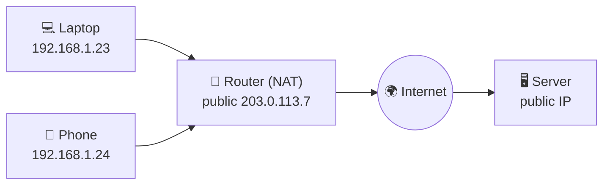
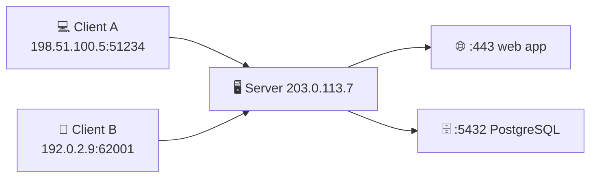

# 🌐 Networking Basics

> [!abstract] 一句话总结 One-line summary
> 两台计算机通信时，**IP 地址**找到设备，**端口**找到设备上的应用，**IP** 负责把数据包送到目的地，**TCP** 负责可靠、按顺序地重组数据，**HTTP** 则承载我们开发者真正关心的应用数据。
> When two computers talk, the **IP address** finds the device, the **port** finds the app on that device, **IP** carries packets to the destination, **TCP** reassembles the data reliably and in order, and **HTTP** carries the application data we developers actually care about.

## 1. 太长不看 TL;DR

- 🏷️ **IP 地址 IP address:** 网络上每台设备的数字标识。IPv4 是 32 位（约 43 亿个），IPv6 是 128 位（几乎用不完）。
  A numeric identifier for each device on a network. IPv4 is 32-bit (about 4.3 billion), IPv6 is 128-bit (practically inexhaustible).
- ✉️ **数据包 Packets:** 数据被切成数据包传输。每个包有**头部**（源地址、目的地址等）和**载荷**（真正的数据）。
  Data travels in packets. Each has a **header** (source, destination, and more) and a **payload** (the actual data).
- 📦 **IP 协议 IP:** 负责寻址和路由，尽力把包送到正确的主机，但**不保证**送达或顺序。
  Handles addressing and routing. It makes a best effort to deliver packets to the right host, but **doesn't guarantee** delivery or order.
- 🔢 **TCP 协议 TCP:** 用序列号、确认和重传，保证数据**可靠**并**按顺序**交给应用。
  Uses sequence numbers, acknowledgments, and retransmission so data reaches the app **reliably** and **in order**.
- 🧅 **分层 Layers:** HTTP（应用层）通常放在 TCP（传输层）里，TCP 再放在 IP（网络层）里，像信封套信封。
  HTTP (application layer) usually sits inside TCP (transport layer), which sits inside IP (network layer), like envelopes inside envelopes.
- 🏠 **公网与私网 Public vs private:** 公网 IP 在整个互联网上可达；私网 IP 只在局域网内可达。
  A public IP is reachable from the whole internet; a private IP only within the local network.
- 🔄 **静态与动态 Static vs dynamic:** 动态 IP 自动分配、可能变化，常用于客户端；静态 IP 固定不变，常用于服务器。
  A dynamic IP is assigned automatically and can change, common for clients; a static IP stays fixed, common for servers.
- 🚪 **端口 Ports:** 16 位的数字（0–65535），区分同一台设备上的不同应用，例如 HTTP 用 80，HTTPS 用 443。
  A 16-bit number (0–65535) that tells apps on one device apart, e.g. 80 for HTTP, 443 for HTTPS.

## 2. 💌 Alice 和 Bob 的类比 The Alice and Bob Analogy

课程用密码学里常见的两个角色 **Alice**（客户端）和 **Bob**（服务器）来讲解。Alice 想给住在另一个城市的 Bob 寄一封生日派对邀请函。
The lesson uses two characters from cryptography, **Alice** (the client) and **Bob** (the server). Alice wants to mail a birthday party invitation to Bob, who lives in another city.

| 寄信 Mailing a letter | 网络 Networking |
| --- | --- |
| Bob 的邮寄地址 Bob's mailing address | IP 地址 IP address |
| 信封上写的地址 The addresses on the envelope | IP 头和 TCP 头 IP and TCP headers |
| 信封里的邀请函 The invitation inside | 载荷（应用数据） Payload (application data) |
| 给多页信编页码 Numbering the pages of a long letter | TCP 序列号 TCP sequence numbers |
| 公寓楼里的房间号 An apartment number in a building | 端口 Port |
| 邮政规则 Postal rules | 协议 Protocols |

> [!tip] 把端口也放进类比 Add ports to the analogy
> IP 地址相当于**大楼地址**，端口相当于**房间号**。一栋楼（一台服务器）里可以住很多人（很多应用），信要写清楚是给哪一间的。
> The IP address is the **building's address** and the port is the **apartment number**. One building (one server) houses many residents (many apps), so the letter must say which apartment it's for.

## 3. 🏷️ IP 地址 IP Addresses

**IP 地址**是连接到网络的每台设备的数字标识，设备靠它发送和接收数据。
An **IP address** is a numeric identifier for each device on a network, used to send and receive data.

| | IPv4 | IPv6 |
| --- | --- | --- |
| 长度 Size | 32-bit | 128-bit |
| 格式 Format | 四个十进制数，用点分隔 Four decimal numbers separated by dots | 八组十六进制数，用冒号分隔 Eight groups of hex digits separated by colons |
| 示例 Example | `192.168.1.10` | `2001:0db8:0000:0000:0000:ff00:0042:8329` |
| 地址总数 Total addresses | $2^{32} \approx 4.3 \times 10^9$ | $2^{128} \approx 3.4 \times 10^{38}$ |
| 现状 Status | 空闲地址池已耗尽，靠 NAT 延续 Free pool exhausted, kept going with NAT | 逐步普及中 Gradually being adopted |

### 3.1 🔢 IPv4 的结构 Anatomy of an IPv4 address

IPv4 地址由 **4 个八位组**（octet）组成，每个八位组是 8 位，也就是 1 字节，所以取值范围是 0 到 255。整体范围是 `0.0.0.0` 到 `255.255.255.255`。
An IPv4 address has **4 octets**. Each octet is 8 bits, or 1 byte, so it ranges from 0 to 255. The full range is `0.0.0.0` to `255.255.255.255`.

```text
  192        168         1          10
11000000 . 10101000 . 00000001 . 00001010
└8 bits┘
└─────────────── 32 bits ───────────────┘
```

> [!example] 为什么最大是 255 Why the max is 255
> 八个位全是 1 时：$2^7 + 2^6 + \dots + 2^0 = 2^8 - 1 = 255$。注意 Java 的 `byte` 是有符号的，192 会变成 -64，所以要用 `b & 0xFF` 取回无符号值。
> With all eight bits set to 1: $2^7 + 2^6 + \dots + 2^0 = 2^8 - 1 = 255$. Note that Java's `byte` is signed, so 192 shows up as -64; use `b & 0xFF` to get the unsigned value.

### 3.2 🔣 IPv6 的写法 Writing IPv6 addresses

IPv6 有 8 组，每组 16 位，写成 4 个十六进制数字。为了好读，有两条缩写规则：
IPv6 has 8 groups of 16 bits, each written as 4 hex digits. Two shortening rules make it readable:

1. 省略每组开头的 0 Drop leading zeros in each group: `0db8` → `db8`, `0042` → `42`
2. 连续全 0 的组可用 `::` 代替，但只能用一次 Replace one run of all-zero groups with `::` (at most once per address)

```text
2001:0db8:0000:0000:0000:ff00:0042:8329
2001:db8::ff00:42:8329
```

> [!note] IPv4 为什么不够用 Why IPv4 ran out
> 43 亿听起来很多，但其中一大块被保留了（私网、组播、回环 `127.0.0.0/8` 等），早期又按大块分给了机构，而联网设备数量增长极快。**NAT**（让很多私网设备共用一个公网 IP）延缓了枯竭，**IPv6** 则从根本上解决了地址数量问题。
> 4.3 billion sounds like a lot, but big blocks are reserved (private, multicast, loopback `127.0.0.0/8`, and more), early allocations handed out huge blocks to organizations, and the number of connected devices grew fast. **NAT** (many private devices sharing one public IP) delayed the exhaustion, and **IPv6** fixes the address count for good.

> [!tip] Java 类比 Java analogy
> `InetAddress.getByName("example.com")` 用 DNS 把域名解析成 IP 地址，返回的是 `Inet4Address` 或 `Inet6Address`。`getAddress()` 对 IPv4 返回 4 字节的 `byte[]`，对 IPv6 返回 16 字节。
> `InetAddress.getByName("example.com")` resolves a hostname to an IP address through DNS and returns an `Inet4Address` or `Inet6Address`. `getAddress()` returns a 4-byte `byte[]` for IPv4 and 16 bytes for IPv6.

## 4. ✉️ 数据包和协议 Packets and Protocols

**协议**是通信双方约定的规则。数据在网络上不是一整块发送的，而是切成一个个**数据包**。
A **protocol** is a set of rules both sides agree on. Data isn't sent over a network as one big block; it's split into **packets**.

### 4.1 📦 IP 协议和数据包 IP and data packets

每个 IP 数据包有两部分：
Each IP packet has two parts:

- **IP 头 IP header:** 源 IP、目的 IP，以及 TTL（IPv6 里叫 Hop Limit）、协议类型等控制信息。对开发者来说最重要的是源地址和目的地址。
  The source IP, the destination IP, and control fields such as TTL (Hop Limit in IPv6) and protocol type. For developers, the source and destination matter most.
- **载荷 Payload:** 要运送的数据，通常是一个 TCP 段或 UDP 数据报。
  The data being carried, usually a TCP segment or UDP datagram.

IP 负责**寻址和路由**：路由器根据目的 IP，一跳一跳地把包转发过去。但 IP 是**尽力而为**的：包可能丢失、重复，或者走不同的路径而**乱序到达**。
IP handles **addressing and routing**: routers forward each packet hop by hop based on its destination IP. But IP is **best effort**: packets can be lost, duplicated, or take different paths and **arrive out of order**.

### 4.2 🔢 TCP 协议 TCP

**TCP**（传输控制协议）建立在 IP 之上，弥补 IP 不可靠的部分：
**TCP** (Transmission Control Protocol) runs on top of IP and fills in what IP doesn't guarantee:

| 机制 Mechanism | 作用 What it does |
| --- | --- |
| 三次握手 Three-way handshake | 发数据前先建立连接（SYN → SYN-ACK → ACK） Sets up a connection before sending data (SYN → SYN-ACK → ACK) |
| 序列号 Sequence numbers | 给每个字节编号，接收方据此把数据**按顺序重组** Numbers every byte so the receiver can **reassemble data in order** |
| 确认 Acknowledgments (ACK) | 接收方告诉发送方收到了哪些数据 The receiver tells the sender what has arrived |
| 重传 Retransmission | 没收到确认的数据会重新发送 Data that isn't acknowledged gets sent again |
| 流量与拥塞控制 Flow & congestion control | 不让发送方压垮接收方或网络 Keeps the sender from overwhelming the receiver or the network |

> [!example] 多页信 The multi-page letter
> Alice 寄一封很长的信，给每页编上页码。不管页序在信封里怎么乱，Bob 都能按页码排好。如果第 3 页丢了，Bob 就不会确认收到它，Alice 等不到确认便补寄。TCP 的序列号、确认和重传做的正是这件事（是发送方因收不到确认而重传）。
> Alice sends a long letter and numbers each page. However the pages get shuffled in the envelope, Bob can put them back in order. If page 3 gets lost, Bob never acknowledges it, so Alice sends it again when no acknowledgment arrives. TCP's sequence numbers, acknowledgments, and retransmission do exactly this (the sender retransmits because the ACK never comes).

> [!note] TCP 和 UDP TCP vs UDP
> 并不是所有应用都用 TCP。**UDP** 没有连接、没有重传、不保证顺序，但开销小、延迟低，适合视频通话、在线游戏这类“晚到不如不到”的场景，以及 DNS 查询这类小而快、丢了由应用重试的一问一答。
> Not everything uses TCP. **UDP** has no connection, no retransmission, and no ordering, but it's lightweight and low-latency. It suits cases where late data is useless, such as video calls and online games, and small one-shot exchanges like DNS queries that the app can simply retry.

### 4.3 🧑‍💻 应用数据 Application data

作为开发者，我们最关心的是**应用数据**，比如一个 HTTP 请求或响应。IP 头和 TCP 头可以先当成黑盒。
As developers, we care most about the **application data**, such as an HTTP request or response. The IP and TCP headers can be treated as a black box for now.

- **POST 请求 POST request:** 我们要发送的数据（例如 JSON）放在 HTTP 请求体里。
  The data we want to send (e.g. JSON) goes in the HTTP request body.
- **GET 请求 GET request:** 请求本身通常只有 URL 和头部，取回的数据在服务器返回的**响应**体里。
  The request itself usually has just the URL and headers; the fetched data comes back in the body of the server's **response**.

一个 TCP 段的载荷里，同时装着 **HTTP 头**和 **HTTP 体**：
A TCP segment's payload holds both the **HTTP headers** and the **HTTP body**:

```text
┌─ IP packet ─────────────────────────────────────────────────────┐
│ IP header  │ ┌─ TCP segment ──────────────────────────────────┐ │
│ src/dst IP │ │ TCP header │ ┌─ HTTP message ────────────────┐ │ │
│            │ │ ports, seq │ │ HTTP headers │ HTTP body      │ │ │
│            │ │            │ │ POST /rsvp   │ {"name":"Bob"} │ │ │
│            │ │            │ └───────────────────────────────┘ │ │
│            │ └────────────────────────────────────────────────┘ │
└─────────────────────────────────────────────────────────────────┘
```

## 5. 🧅 网络分层 Network Layers

网络协议按**层**组织。每一层只负责一件事，在同一台主机内只和上下相邻的层打交道。发送时每层在外面**加一层头**（封装），接收时逐层**拆开**（解封装）。
Network protocols are organized into **layers**. Each layer has one job and, within a host, only talks to the layers right above and below it. On the way out, each layer **wraps** the data with its own header (encapsulation); on the way in, each layer **unwraps** it (decapsulation).

| TCP/IP 层 TCP/IP layer | OSI 层 OSI layer | 职责 Responsibility | 例子 Examples |
| --- | --- | --- | --- |
| 应用层 Application | 第 5–7 层 Layers 5–7 | 应用之间的对话 Conversations between apps | HTTP, DNS, SMTP |
| 传输层 Transport | 第 4 层 Layer 4 | 端口到端口、可靠性 Port to port, reliability | TCP, UDP |
| 网络层 Network (Internet) | 第 3 层 Layer 3 | 主机到主机的寻址和路由 Host-to-host addressing and routing | IP |
| 链路层 Link | 第 1–2 层 Layers 1–2 | 同一段网络内传输比特 Moving bits across one local link | Ethernet, Wi-Fi |

> [!tip] Java 类比：分层像调用栈 Java analogy: layers are like a call stack
> 你的 Spring 控制器只处理 HTTP，不关心底下是 Wi-Fi 还是网线，就像业务代码调用 `HttpClient`，而 `HttpClient` 调用 `Socket`，`Socket` 再交给操作系统。每一层都只依赖下一层的接口。
> Your Spring controller deals only with HTTP and doesn't care whether there's Wi-Fi or a cable underneath, just as business code calls `HttpClient`, which calls a `Socket`, which hands off to the OS. Each layer depends only on the interface of the one below.

## 6. 🏠 公网 IP 与私网 IP Public vs Private IP Addresses

| | 🌍 公网 IP Public IP | 🏠 私网 IP Private IP |
| --- | --- | --- |
| 可达范围 Reachable from | 整个互联网 The whole internet | 只在局域网内 Only inside the LAN |
| 唯一性 Uniqueness | 全球唯一 Globally unique | 只在本网络内唯一，不同网络可重复 Unique only within its network; reused across networks |
| 谁分配 Assigned by | ISP 或云服务商 The ISP or a cloud provider | 路由器（DHCP）或管理员 The router (DHCP) or an admin |
| 地址范围 Ranges | 私网和保留范围以外的地址 Everything outside private and reserved ranges | `10.0.0.0/8`, `172.16.0.0/12`, `192.168.0.0/16` |

家里的手机、电脑都有私网 IP（比如 `192.168.1.23`），它们访问互联网时，路由器用 **NAT** 把它们换成同一个公网 IP。所以外面的服务器看到的是路由器的公网地址。路由器通常还会改写源端口（叫 NAPT），靠端口区分是哪台设备的连接（见第 8 节的四元组）。
The phones and laptops at home have private IPs (e.g. `192.168.1.23`). When they reach the internet, the router uses **NAT** to swap them for one shared public IP, so outside servers see the router's public address. The router usually rewrites source ports too (called NAPT) and uses them to tell each device's connections apart (see the 4-tuple in section 8).



## 7. 🔄 静态 IP 与动态 IP Static vs Dynamic IP Addresses

| | 🔄 动态 IP Dynamic IP | 📌 静态 IP Static IP |
| --- | --- | --- |
| 分配方式 Assignment | **DHCP** 自动分配，带租期 Assigned automatically by **DHCP**, with a lease | 手动配置，或固定绑定 Configured by hand, or a fixed binding |
| 会变吗？ Does it change? | 可能会变，例如重连或租期到期后 It can, e.g. after reconnecting or when the lease expires | 不变，除非手动修改 Not unless you change it |
| 优点 Pros | 零配置，地址池可以复用 No setup; the address pool gets reused | 好找、稳定 Easy to find and stable |
| 常用于 Typical use | 客户端：手机、笔记本 Clients: phones, laptops | 服务器、打印机、DNS 记录指向的机器 Servers, printers, machines a DNS record points to |

> [!note] 客户端也可以用静态 IP Clients can be static too
> 客户端也可以有静态 IP，但动态 IP 更常见，因为它能更灵活地管理有限的地址池。服务器需要稳定地址，好让客户端（和 DNS 记录）一直找得到它。在云上通常用**弹性 IP**，或者干脆用 DNS 名称加负载均衡器，而不是让客户端记住某个 IP。
> Clients can have static IPs, but dynamic ones are more common because they make better use of the limited address pool. Servers need a stable address so clients (and DNS records) can always find them. In the cloud you usually use an **elastic IP**, or just a DNS name in front of a load balancer, instead of making clients remember an IP.

## 8. 🚪 端口 Ports

IP 地址找到**设备**，**端口**找到设备上的**应用**。端口是 16 位整数，范围 0 到 65535。
An IP address finds the **device**; a **port** finds the **app** on that device. A port is a 16-bit integer from 0 to 65535.

| 范围 Range | 名称 Name | 例子 Examples |
| --- | --- | --- |
| 0–1023 | 知名端口 Well-known ports | 22 SSH, 53 DNS, 80 HTTP, 443 HTTPS |
| 1024–49151 | 注册端口 Registered ports | 3306 MySQL, 5432 PostgreSQL, 8080 dev servers |
| 49152–65535 | 动态端口 Dynamic (ephemeral) ports | 通常由客户端连接时临时使用（Linux 默认 32768–60999） Usually picked temporarily by clients for outgoing connections (Linux defaults to 32768–60999) |

> [!example] 全栈项目里的端口 Ports in a full-stack project
> Angular 开发服务器默认跑在 **4200**，Spring Boot 默认 **8080**。如果再启动一个也想监听 4200 的应用，就会失败，因为这个端口已经被占用了（`ng serve` 会提示改用别的端口）。
> The Angular dev server runs on **4200** by default and Spring Boot on **8080**. Starting another app that also wants to listen on 4200 fails, because the port is already taken (`ng serve` offers to use another port).

```java
import java.io.IOException;
import java.net.BindException;
import java.net.ServerSocket;

public class PortDemo {
    public static void main(String[] args) throws IOException {
        // 第二次绑定同一端口会失败 Binding the same port twice fails
        try (ServerSocket a = new ServerSocket(4200);
             ServerSocket b = new ServerSocket(4200)) {
            System.out.println("never reached");
        } catch (BindException e) {
            // 例如 e.g. "Address already in use"（措辞因系统而异 wording varies by OS）
            System.out.println("Port 4200 is taken: " + e.getMessage());
        }
    }
}
```

> [!important] 一个端口可以有很多连接 One port, many connections
> “一个端口只能给一个应用”说的是**监听**。一台服务器的 443 端口可以同时和成千上万个客户端连接，因为每个 TCP 连接由**四元组**唯一确定：源 IP、源端口、目的 IP、目的端口。每个客户端用的是自己的临时端口。
> "One app per port" is about **listening**. A server's port 443 can hold thousands of connections at once, because each TCP connection is identified by a **4-tuple**: source IP, source port, destination IP, destination port. Each client uses its own ephemeral port.



## 9. 🗺️ 把一切串起来 Putting It Together

浏览器访问 `https://example.com/rsvp` 时，大致会发生：
When a browser opens `https://example.com/rsvp`, roughly this happens:

1. 🔎 **DNS 查询 DNS lookup:** 把 `example.com` 解析成 IP 地址。
   Resolve `example.com` to an IP address.
2. 🤝 **TCP 握手 TCP handshake:** 和这个 IP 的 **443** 端口建立连接（HTTPS 还要再做一次 TLS 握手；HTTP/3 则改用基于 UDP 的 QUIC）。
   Open a connection to port **443** at that IP (HTTPS adds a TLS handshake on top; HTTP/3 uses QUIC over UDP instead).
3. 📤 **发送请求 Send the request:** HTTP 请求被 TCP 切成段、IP 装成包，经过路由器一跳一跳到达服务器。
   TCP splits the HTTP request into segments, IP wraps them in packets, and routers forward them hop by hop to the server.
4. 🧩 **重组 Reassemble:** 服务器的 TCP 按序列号重组数据，交给监听 443 端口的应用。
   The server's TCP reassembles the data by sequence number and hands it to the app listening on 443.
5. 📥 **返回响应 Respond:** 响应沿同样的方式回到浏览器的临时端口。
   The response travels back the same way to the browser's ephemeral port.

## 10. ⚠️ 对课程原文的澄清 Clarifications to the Lesson Text

- **“数据包由头部、载荷和尾部组成” "Packets consist of a header, payload, and trailer":** IP 数据包只有**头部和载荷**，没有尾部。尾部（比如以太网的校验序列 FCS）属于链路层的**帧**。
  An IP packet has only a **header and a payload**, no trailer. The trailer (such as Ethernet's frame check sequence) belongs to the link-layer **frame**.
- **“IP 和 TCP 一起保证数据准确送达” "TCP and IP together guarantee precise delivery":** IP 本身是**尽力而为**的，不保证送达。可靠性主要来自 TCP 的确认和重传；即使这样，网络断了 TCP 也只能报错，不能“保证”送到。
  IP itself is **best effort** and guarantees nothing. Reliability mainly comes from TCP's acknowledgments and retransmission, and even TCP can only report an error, not "guarantee" delivery, if the network is down.
- **“TCP 确保包按正确顺序到达” "TCP ensures packets arrive in the right sequence":** 包在网络上仍然可能乱序到达。TCP 是在**接收端**按序列号重新排序，再交给应用。另外序列号是给**字节**编号的，不是给包编号。
  Packets can still arrive out of order on the wire. TCP reorders them **at the receiver** by sequence number before handing data to the app. Also, sequence numbers count **bytes**, not packets.
- **“网络层设定数据传输的物理路径” "The network layer sets the physical pathway":** 网络层负责**逻辑**寻址和路由（选下一跳）。物理传输是链路层和物理层的事。
  The network layer handles **logical** addressing and routing (choosing the next hop). Physical transmission belongs to the link and physical layers.
- **“GET 请求的数据段就是取回的响应” "For a GET, the packet's data is the retrieved response":** 请求和响应是**两条不同的消息**。GET 请求通常只有 URL 和头部，取回的数据在服务器的响应体里。
  The request and the response are **two separate messages**. A GET request usually carries just the URL and headers; the fetched data is in the server's response body.
- **“IPv6 几乎无限” "IPv6 is virtually infinite":** 它是有限的，约 $3.4 \times 10^{38}$ 个，只是多到实际上用不完。而且 IPv6 地址可以缩写（省略前导 0、用 `::`）。
  It's finite, about $3.4 \times 10^{38}$, just too many to run out of in practice. IPv6 addresses can also be shortened (drop leading zeros, use `::`).
- **IPv4 为什么不够 Why IPv4 is short:** 课程说是“设计选择”。具体来说是大块的保留地址和早期粗放的分配。**NAT** 也是 IPv4 能撑到今天的重要原因。
  The lesson says "design choices". Concretely: large reserved ranges and wasteful early allocations. **NAT** is also a big reason IPv4 has lasted this long.
- **“公网 IP 由 ISP 提供” "Public IPs are supplied by the ISP":** 家庭网络是这样，但云服务商（AWS、GCP）也分配公网 IP。而且家里通常是**整个网络共用一个**公网 IP，不是每台设备一个。
  True for home networks, but cloud providers (AWS, GCP) also assign public IPs. And a home usually **shares one** public IP across the whole network via NAT, not one per device.
- **“动态 IP 每次连接都会变” "A dynamic IP can change every time the device connects":** 它*可能*变，但 DHCP 通常会续租同一个地址，所以常常好几天都不变。
  It *can* change, but DHCP often renews the same address, so it frequently stays the same for days.
- **“静态 IP 需要手动配置” "Static IPs require manual configuration":** 也可以在路由器上做 **DHCP 预留**，或在云上用弹性 IP，效果一样是固定地址。
  A **DHCP reservation** on the router or an elastic IP in the cloud also gives a fixed address without configuring the device by hand.
- **“前端和后端不能用同一个端口” "Frontend and backend can't use the same port":** 准确地说，是同一个 IP 上、同一种协议（TCP 或 UDP）里，同一个端口只能有一个应用**监听**（`SO_REUSEPORT` 等选项除外）。但一个端口可以同时承载很多**连接**（见四元组）。
  Precisely: only one app can **listen** on a given port for the same IP and protocol (TCP or UDP), except with options like `SO_REUSEPORT`. One port can still carry many **connections** at once (see the 4-tuple).
- **术语 Terminology:** 课程把各层的数据都叫“包”。严格说：链路层是**帧**，IP 层通常叫**包**（RFC 里也叫数据报），TCP 层是**段**，UDP 层是**数据报**。面试时用对词会加分。
  The lesson calls everything a "packet". Strictly: a **frame** at the link layer, a **packet** at IP (RFCs also say datagram), a **segment** for TCP, and a **datagram** for UDP. Using the right word helps in interviews.

## 11. 🧩 复习题 Review Questions

**Q1.** IPv4 和 IPv6 地址各有多少位？各自大约有多少个地址？ How many bits are IPv4 and IPv6 addresses, and roughly how many addresses does each allow?

> [!success]- 答案 Answer
> IPv4 是 32 位，约 $4.3 \times 10^9$ 个；IPv6 是 128 位，约 $3.4 \times 10^{38}$ 个。
> IPv4 is 32-bit, about $4.3 \times 10^9$ addresses; IPv6 is 128-bit, about $3.4 \times 10^{38}$.

**Q2.** 为什么 IPv4 的每个八位组最大是 255？ Why is each IPv4 octet at most 255?

> [!success]- 答案 Answer
> 每个八位组是 8 位，8 位无符号数的最大值是 $2^8 - 1 = 255$。
> Each octet is 8 bits, and the largest unsigned 8-bit value is $2^8 - 1 = 255$.

**Q3.** IP 和 TCP 各负责什么？ What does IP do, and what does TCP add?

> [!success]- 答案 Answer
> IP 负责寻址和路由，尽力把包送到目的主机，但不保证送达或顺序。TCP 在此之上用序列号、确认和重传，让数据可靠、按顺序地交给应用。
> IP handles addressing and routing, making a best effort to get packets to the destination host without guaranteeing delivery or order. TCP adds sequence numbers, acknowledgments, and retransmission so data reaches the app reliably and in order.

**Q4.** 一个 HTTP POST 请求在网络上是怎么被封装的？ How is an HTTP POST request wrapped on its way over the network?

> [!success]- 答案 Answer
> HTTP 头和请求体是 TCP 段的载荷；TCP 段（加上端口、序列号等 TCP 头）又是 IP 包的载荷；IP 包（加上源、目的 IP）再被链路层装进帧。
> The HTTP headers and body are the TCP segment's payload; the TCP segment (with its header: ports, sequence number) is the IP packet's payload; the IP packet (with source and destination IPs) is then put into a link-layer frame.

**Q5.** 公网 IP 和私网 IP 有什么区别？家里的设备怎么上网？ What's the difference between public and private IPs, and how do home devices reach the internet?

> [!success]- 答案 Answer
> 公网 IP 全球唯一、整个互联网可达；私网 IP 只在局域网内可达，不同网络可以重复。家里的设备用私网 IP，路由器通过 NAT 让它们共用一个公网 IP 上网。
> A public IP is globally unique and reachable from anywhere on the internet; a private IP is reachable only inside the LAN and can be reused across networks. Home devices use private IPs, and the router uses NAT to share one public IP among them.

**Q6.** 为什么服务器通常用静态 IP，客户端通常用动态 IP？ Why do servers usually get static IPs while clients get dynamic ones?

> [!success]- 答案 Answer
> 服务器需要稳定的地址，客户端和 DNS 记录才能一直找到它。客户端只发起连接，不需要被找到，动态分配可以零配置并复用有限的地址池。
> Servers need a stable address so clients and DNS records can always find them. Clients only start connections and don't need to be found, so dynamic assignment needs no setup and reuses the limited address pool.

**Q7.** 端口是什么？范围是多少？ What is a port, and what's its range?

> [!success]- 答案 Answer
> 端口是 16 位整数，用来区分同一台设备上的不同应用或服务，范围是 0 到 65535。例如 HTTP 用 80，HTTPS 用 443。
> A port is a 16-bit integer that tells apps or services on one device apart, ranging from 0 to 65535. For example, HTTP uses 80 and HTTPS uses 443.

**Q8.** 既然一个端口只能被一个应用监听，为什么一台服务器的 443 端口能同时服务成千上万个用户？ If only one app can listen on a port, how can a server's port 443 serve thousands of users at once?

> [!success]- 答案 Answer
> 因为每个 TCP 连接由四元组（源 IP、源端口、目的 IP、目的端口）唯一确定。每个客户端的 IP 或临时端口不同，所以它们在同一个监听端口上是不同的连接。
> Each TCP connection is identified by its 4-tuple (source IP, source port, destination IP, destination port). Each client has a different IP or ephemeral port, so they're separate connections on the same listening port.

**Q9.** 什么时候会选 UDP 而不是 TCP？ When would you pick UDP over TCP?

> [!success]- 答案 Answer
> 当低延迟比可靠性更重要、晚到的数据没有用的时候，比如视频通话和在线游戏。DNS 查询也常用 UDP，因为它是小而快的一问一答，丢了由应用重试即可。
> When low latency matters more than reliability and late data is useless, such as video calls and online games. DNS queries also usually use UDP, because they're small one-shot exchanges the app can simply retry.

## 12. 🔗 相关 Related

- ⬅️ 上一篇 Previous: [[Design Requirements|设计需求 Design Requirements]]
- [[Application Architecture|应用架构 Application Architecture]]
- [[📌 系统设计总览|系统设计总览 System Design Overview]]
