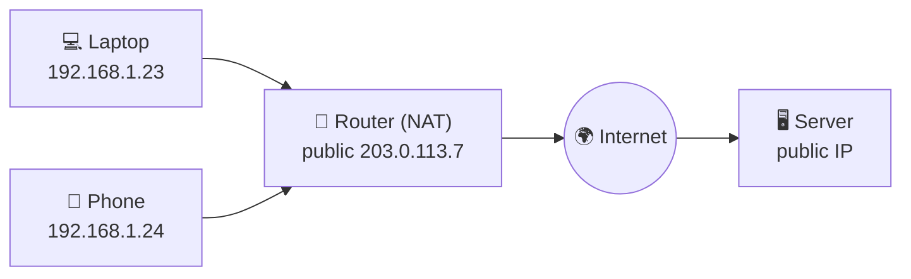

# 🌐 Networking Basics

> [!abstract] 一句话总结 One-line summary
> 两台计算机通信时，**IP 地址**找到设备，**端口**找到设备上的应用，**IP** 负责把数据包送到目的地，**TCP** 负责可靠、按顺序地重组数据，**HTTP** 则承载我们开发者真正关心的应用数据。
> When two computers talk, the **IP address** finds the device, the **port** finds the app on that device, **IP** carries packets to the destination, **TCP** reassembles the data reliably and in order, and **HTTP** carries the application data we developers actually care about.

## 1. 太长不看 TL;DR

- 🏷️ **IP 地址 IP address:** 网络上每台设备的数字标识。IPv4 是 32 位（约 43 亿个），IPv6 是 128 位（几乎用不完）。
  A numeric identifier for each device on a network. IPv4 is 32-bit (about 4.3 billion), IPv6 is 128-bit (practically inexhaustible).
- ✉️ **数据包 Packets:** 数据被切成数据包传输。每个包有**头部**（源地址、目的地址等）和**载荷**（真正的数据）。
  Data travels in packets. Each has a **header** (source, destination, and more) and a **payload** (the actual data).
- 📦 **IP 协议 IP:** 负责寻址和路由，尽力把包送到正确的主机，但**不保证**送达或顺序。
  Handles addressing and routing. It makes a best effort to deliver packets to the right host, but **doesn't guarantee** delivery or order.
- 🔢 **TCP 协议 TCP:** 用序列号、确认和重传，保证数据**可靠**并**按顺序**交给应用。
  Uses sequence numbers, acknowledgments, and retransmission so data reaches the app **reliably** and **in order**.
- 🧅 **分层 Layers:** HTTP（应用层）通常放在 TCP（传输层）里，TCP 再放在 IP（网络层）里，像信封套信封。
  HTTP (application layer) usually sits inside TCP (transport layer), which sits inside IP (network layer), like envelopes inside envelopes.
- 🏠 **公网与私网 Public vs private:** 公网 IP 在整个互联网上可达；私网 IP 只在局域网内可达。
  A public IP is reachable from the whole internet; a private IP only within the local network.
- 🔄 **静态与动态 Static vs dynamic:** 动态 IP 自动分配、可能变化，常用于客户端；静态 IP 固定不变，常用于服务器。
  A dynamic IP is assigned automatically and can change, common for clients; a static IP stays fixed, common for servers.
- 🚪 **端口 Ports:** 16 位的数字（0–65535），区分同一台设备上的不同应用，例如 HTTP 用 80，HTTPS 用 443。
  A 16-bit number (0–65535) that tells apps on one device apart, e.g. 80 for HTTP, 443 for HTTPS.

## 2. 💌 Alice 和 Bob 的类比 The Alice and Bob Analogy

**Alice**（客户端）给另一个城市的 **Bob**（服务器）寄一封生日邀请函：
**Alice** (the client) mails a birthday invitation to **Bob** (the server) in another city:

| 寄信 Mailing a letter | 网络 Networking |
| --- | --- |
| Bob 的大楼地址 Bob's building address | IP 地址 IP address |
| 大楼里的房间号 The apartment number in that building | 端口 Port |
| 信封上的地址 The addresses on the envelope | IP 头和 TCP 头 IP and TCP headers |
| 信封里的邀请函 The invitation inside | 载荷（应用数据） Payload (application data) |
| 给多页信编页码，丢了就补寄 Numbering the pages, resending any that get lost | TCP 序列号、确认和重传 TCP sequence numbers, ACKs, and retransmission |
| 邮政规则 Postal rules | 协议 Protocols |

## 3. 🏷️ IP 地址 IP Addresses

| | IPv4 | IPv6 |
| --- | --- | --- |
| 长度 Size | 32-bit | 128-bit |
| 格式 Format | 四个十进制数，用点分隔 Four decimal numbers separated by dots | 八组十六进制数，用冒号分隔 Eight groups of hex digits separated by colons |
| 示例 Example | `192.168.1.10` | `2001:db8::ff00:42:8329` |
| 地址总数 Total addresses | $2^{32} \approx 4.3 \times 10^9$ | $2^{128} \approx 3.4 \times 10^{38}$ |
| 现状 Status | 空闲地址池已耗尽，靠 NAT 延续 Free pool exhausted, kept going with NAT | 逐步普及中 Gradually being adopted |

- **IPv4 的结构 IPv4 anatomy:** 四个八位组（octet），每个 8 位，也就是 1 字节，所以取值范围是 0 到 255（$2^8 - 1$）。
  Four octets of 8 bits (1 byte) each, so each ranges from 0 to 255 ($2^8 - 1$).
- **IPv6 的缩写 IPv6 shorthand:** 省略每组开头的 0，连续全 0 的组可用 `::` 代替一次。
  Drop leading zeros in each group, and replace one run of all-zero groups with `::`.

```text
  192        168         1          10
11000000 . 10101000 . 00000001 . 00001010      ← IPv4: 4 × 8 bits = 32 bits

2001:0db8:0000:0000:0000:ff00:0042:8329        ← IPv6 in full
2001:db8::ff00:42:8329                          ← shortened
```

> [!note] IPv4 为什么不够用 Why IPv4 ran out
> 43 亿里有一大块被保留（私网、组播、回环等），早期又按大块分给了机构，而联网设备增长极快。**NAT**（很多私网设备共用一个公网 IP）延缓了枯竭，**IPv6** 从根本上解决了数量问题。
> Big blocks of the 4.3 billion are reserved (private, multicast, loopback, and more), early allocations handed out huge blocks, and connected devices grew fast. **NAT** (many private devices sharing one public IP) delayed the exhaustion; **IPv6** fixes the count for good.

## 4. ✉️ 数据包和协议 Packets and Protocols

**协议**是通信双方约定的规则。数据不是一整块发送的，而是切成**数据包**。每个 IP 包有 **IP 头**（源 IP、目的 IP、TTL、协议类型等）和**载荷**（通常是一个 TCP 段或 UDP 数据报）。
A **protocol** is a set of rules both sides agree on. Data isn't sent as one block; it's split into **packets**. Each IP packet has an **IP header** (source IP, destination IP, TTL, protocol type, and more) and a **payload** (usually a TCP segment or UDP datagram).

- **IP 做什么 What IP does:** 寻址和路由，路由器根据目的 IP 一跳一跳转发。但 IP 是**尽力而为**的：包可能丢失、重复或**乱序到达**。
  Addressing and routing: routers forward each packet hop by hop by destination IP. But IP is **best effort**: packets can be lost, duplicated, or **arrive out of order**.
- **TCP 补什么 What TCP adds:** 在 IP 之上提供一条可靠、有序的字节流。
  A reliable, ordered byte stream on top of IP.

| TCP 机制 TCP mechanism | 作用 What it does |
| --- | --- |
| 三次握手 Three-way handshake | 发数据前先建立连接（SYN → SYN-ACK → ACK） Sets up a connection before sending data (SYN → SYN-ACK → ACK) |
| 序列号 Sequence numbers | 给每个字节编号，接收方据此**按顺序重组** Numbers every byte so the receiver can **reassemble data in order** |
| 确认和重传 ACKs and retransmission | 没收到确认的数据会重新发送 Data that isn't acknowledged gets sent again |
| 流量与拥塞控制 Flow and congestion control | 不让发送方压垮接收方或网络 Keeps the sender from overwhelming the receiver or the network |

> [!note] TCP 和 UDP TCP vs UDP
> **UDP** 没有连接、重传和顺序保证，但开销小、延迟低，适合视频通话、游戏这类“晚到不如不到”的场景和 DNS 这类小而快的一问一答。
> **UDP** has no connection, retransmission, or ordering, but it's lightweight and low-latency, which suits video calls and games (late data is useless) and small one-shot exchanges like DNS.
> 👉 详见下一篇 More in the next note: [[TCP and UDP|TCP 与 UDP 协议 TCP and UDP]]

### 4.1 🧑‍💻 应用数据 Application data

作为开发者，我们最关心的是**应用数据**，比如一个 HTTP 请求或响应；IP 头和 TCP 头可以先当成黑盒。POST 的数据放在请求体里；GET 请求通常只有 URL 和头部，取回的数据在服务器**响应**的体里。
As developers, we care most about the **application data**, such as an HTTP request or response; the IP and TCP headers can be a black box for now. A POST carries its data in the request body; a GET usually has just the URL and headers, and the fetched data comes back in the body of the server's **response**.

```text
┌─ IP packet ─────────────────────────────────────────────────────┐
│ IP header  │ ┌─ TCP segment ──────────────────────────────────┐ │
│ src/dst IP │ │ TCP header │ ┌─ HTTP message ────────────────┐ │ │
│            │ │ ports, seq │ │ HTTP headers │ HTTP body      │ │ │
│            │ │            │ │ POST /rsvp   │ {"name":"Bob"} │ │ │
│            │ │            │ └───────────────────────────────┘ │ │
│            │ └────────────────────────────────────────────────┘ │
└─────────────────────────────────────────────────────────────────┘
```

## 5. 🧅 网络分层 Network Layers

每一层只负责一件事，只和上下相邻的层打交道。发送时每层在外面**加一层头**（封装），接收时逐层**拆开**（解封装）。
Each layer has one job and only talks to the layers right above and below it. On the way out, each layer **wraps** the data with its own header (encapsulation); on the way in, each layer **unwraps** it (decapsulation).

| TCP/IP 层 TCP/IP layer | OSI 层 OSI layer | 职责 Responsibility | 例子 Examples |
| --- | --- | --- | --- |
| 应用层 Application | 第 5–7 层 Layers 5–7 | 应用之间的对话 Conversations between apps | HTTP, DNS, SMTP |
| 传输层 Transport | 第 4 层 Layer 4 | 端口到端口、可靠性 Port to port, reliability | TCP, UDP |
| 网络层 Network (Internet) | 第 3 层 Layer 3 | 主机到主机的寻址和路由 Host-to-host addressing and routing | IP |
| 链路层 Link | 第 1–2 层 Layers 1–2 | 同一段网络内传输比特 Moving bits across one local link | Ethernet, Wi-Fi |

> [!tip] Java 类比 Java analogy
> 分层像调用栈：业务代码调用 `HttpClient`，它调用 `Socket`，`Socket` 再交给操作系统。每一层只依赖下一层的接口。
> Layers are like a call stack: business code calls `HttpClient`, which calls a `Socket`, which hands off to the OS. Each layer depends only on the interface of the one below.

## 6. 🏠 公网 IP 与私网 IP Public vs Private IP Addresses

| | 🌍 公网 IP Public IP | 🏠 私网 IP Private IP |
| --- | --- | --- |
| 可达范围 Reachable from | 整个互联网 The whole internet | 只在局域网内 Only inside the LAN |
| 唯一性 Uniqueness | 全球唯一 Globally unique | 只在本网络内唯一，不同网络可重复 Unique only within its network; reused across networks |
| 谁分配 Assigned by | ISP 或云服务商 The ISP or a cloud provider | 路由器（DHCP）或管理员 The router (DHCP) or an admin |
| 地址范围 Ranges | 私网和保留范围以外的地址 Everything outside private and reserved ranges | `10.0.0.0/8`, `172.16.0.0/12`, `192.168.0.0/16` |

家里的设备都有私网 IP，上网时路由器用 **NAT** 把它们换成同一个公网 IP（通常还会改写源端口，靠端口区分是哪台设备的连接）。外面的服务器看到的是路由器的公网地址。
Home devices have private IPs. When they reach the internet, the router uses **NAT** to swap them for one shared public IP (usually rewriting the source port too, to tell each device's connections apart). Outside servers see the router's public address.



## 7. 🔄 静态 IP 与动态 IP Static vs Dynamic IP Addresses

| | 🔄 动态 IP Dynamic IP | 📌 静态 IP Static IP |
| --- | --- | --- |
| 分配方式 Assignment | **DHCP** 自动分配，带租期 Assigned automatically by **DHCP**, with a lease | 手动配置、DHCP 预留或云上的弹性地址 Configured by hand, a DHCP reservation, or an elastic IP in the cloud |
| 会变吗？ Does it change? | 可能会变，但 DHCP 通常续租同一个地址 It can, though DHCP usually renews the same address | 不变，除非手动修改 Not unless you change it |
| 常用于 Typical use | 客户端：零配置，地址池可复用 Clients: no setup, and the address pool gets reused | 服务器：客户端和 DNS 记录要一直找得到它 Servers: clients and DNS records must always find them |

> [!note] 云上的做法 In the cloud
> 通常用 DNS 名称加负载均衡器，而不是让客户端记住某个 IP。
> You usually put a DNS name in front of a load balancer instead of making clients remember an IP.

## 8. 🚪 端口 Ports

IP 地址找到**设备**，**端口**找到设备上的**应用**。端口是 16 位整数，范围 0 到 65535。
An IP address finds the **device**; a **port** finds the **app** on that device. A port is a 16-bit integer from 0 to 65535.

| 范围 Range | 名称 Name | 例子 Examples |
| --- | --- | --- |
| 0–1023 | 知名端口 Well-known ports | 22 SSH, 53 DNS, 80 HTTP, 443 HTTPS |
| 1024–49151 | 注册端口 Registered ports | 3306 MySQL, 5432 PostgreSQL, 8080 dev servers |
| 49152–65535 | 动态端口 Dynamic (ephemeral) ports | 客户端连接时临时使用（Linux 默认 32768–60999） Picked temporarily by clients for outgoing connections (Linux defaults to 32768–60999) |

> [!example] 全栈项目里的端口 Ports in a full-stack project
> Angular 开发服务器默认跑在 **4200**，Spring Boot 默认 **8080**。再启动一个也想监听 4200 的应用会失败（`BindException: Address already in use`），因为同一个 IP 和协议上，一个端口只能有一个应用**监听**。
> The Angular dev server runs on **4200** by default and Spring Boot on **8080**. Starting another app that also wants to listen on 4200 fails (`BindException: Address already in use`), because only one app can **listen** on a port for the same IP and protocol.

> [!important] 一个端口可以有很多连接 One port, many connections
> “一个端口只能给一个应用”说的是**监听**。服务器的 443 端口可以同时和成千上万个客户端连接，因为每个 TCP 连接由**四元组**唯一确定：源 IP、源端口、目的 IP、目的端口。每个客户端用的是自己的临时端口。
> "One app per port" is about **listening**. A server's port 443 can hold thousands of connections at once, because each TCP connection is identified by a **4-tuple**: source IP, source port, destination IP, destination port. Each client uses its own ephemeral port.

## 9. 🗺️ 把一切串起来 Putting It Together

浏览器访问 `https://example.com/rsvp` 时，大致会发生：
When a browser opens `https://example.com/rsvp`, roughly this happens:

1. 🔎 **DNS 查询 DNS lookup:** 把 `example.com` 解析成 IP 地址。
   Resolve `example.com` to an IP address.
2. 🤝 **TCP 握手 TCP handshake:** 和这个 IP 的 **443** 端口建立连接（HTTPS 再做一次 TLS 握手；HTTP/3 则改用基于 UDP 的 QUIC）。
   Open a connection to port **443** at that IP (HTTPS adds a TLS handshake; HTTP/3 uses QUIC over UDP instead).
3. 📤 **发送请求 Send the request:** HTTP 请求被 TCP 切成段、IP 装成包，经路由器一跳一跳到达服务器。
   TCP splits the HTTP request into segments, IP wraps them in packets, and routers forward them hop by hop.
4. 🧩 **重组 Reassemble:** 服务器的 TCP 按序列号重组数据，交给监听 443 的应用。
   The server's TCP reassembles the data by sequence number and hands it to the app listening on 443.
5. 📥 **返回响应 Respond:** 响应沿同样的方式回到浏览器的临时端口。
   The response travels back the same way to the browser's ephemeral port.

## 10. ⚠️ 对课程原文的澄清 Clarifications to the Lesson Text

- **“数据包由头部、载荷和尾部组成” "Packets consist of a header, payload, and trailer":** IP 包只有**头部和载荷**。尾部（如以太网的校验序列）属于链路层的**帧**。
  An IP packet has only a **header and a payload**. The trailer (such as Ethernet's frame check sequence) belongs to the link-layer **frame**.
- **“IP 和 TCP 一起保证数据准确送达” "TCP and IP together guarantee precise delivery":** IP 是**尽力而为**的。可靠性来自 TCP 的确认和重传；网络断了 TCP 也只能报错，不能“保证”送到。
  IP is **best effort**. Reliability comes from TCP's acknowledgments and retransmission, and even TCP can only report an error, not "guarantee" delivery, if the network is down.
- **“TCP 确保包按正确顺序到达” "TCP ensures packets arrive in the right sequence":** 包仍可能乱序到达；TCP 在**接收端**按序列号重排。序列号给**字节**编号，不是给包编号。
  Packets can still arrive out of order; TCP reorders them **at the receiver**. Sequence numbers count **bytes**, not packets.
- **“GET 请求的数据段就是取回的响应” "For a GET, the packet's data is the retrieved response":** 请求和响应是**两条不同的消息**；取回的数据在响应体里。
  The request and the response are **two separate messages**; the fetched data is in the response body.
- **“公网 IP 由 ISP 提供，每台设备一个” "Public IPs come from the ISP, one per device":** 云服务商也分配公网 IP，而且家里通常是**整个网络共用一个**公网 IP（NAT）。
  Cloud providers assign public IPs too, and a home usually **shares one** public IP across the whole network (NAT).
- **“前端和后端不能用同一个端口” "Frontend and backend can't use the same port":** 准确地说，同一个 IP 和协议上，一个端口只能有一个应用**监听**（`SO_REUSEPORT` 等选项除外），但可以同时承载很多**连接**。
  Precisely: only one app can **listen** on a port for the same IP and protocol (except with options like `SO_REUSEPORT`), but one port can carry many **connections** at once.
- **术语 Terminology:** 课程把各层的数据都叫“包”。严格说：链路层是**帧**，IP 层是**包**，TCP 是**段**，UDP 是**数据报**。
  The lesson calls everything a "packet". Strictly: a **frame** at the link layer, a **packet** at IP, a **segment** for TCP, and a **datagram** for UDP.

## 11. 🧩 复习题 Review Questions

**Q1.** IPv4 和 IPv6 地址各有多少位？各自大约有多少个地址？ How many bits are IPv4 and IPv6 addresses, and roughly how many addresses does each allow?

> [!success]- 答案 Answer
> IPv4 是 32 位，约 $4.3 \times 10^9$ 个；IPv6 是 128 位，约 $3.4 \times 10^{38}$ 个。
> IPv4 is 32-bit, about $4.3 \times 10^9$ addresses; IPv6 is 128-bit, about $3.4 \times 10^{38}$.

**Q2.** IP 和 TCP 各负责什么？ What does IP do, and what does TCP add?

> [!success]- 答案 Answer
> IP 负责寻址和路由，尽力把包送到目的主机，但不保证送达或顺序。TCP 在此之上用序列号、确认和重传，让数据可靠、按顺序地交给应用。
> IP handles addressing and routing, making a best effort to get packets to the destination host without guaranteeing delivery or order. TCP adds sequence numbers, acknowledgments, and retransmission so data reaches the app reliably and in order.

**Q3.** 一个 HTTP POST 请求在网络上是怎么被封装的？ How is an HTTP POST request wrapped on its way over the network?

> [!success]- 答案 Answer
> HTTP 头和请求体是 TCP 段的载荷；TCP 段（加上端口、序列号等 TCP 头）是 IP 包的载荷；IP 包再被链路层装进帧。
> The HTTP headers and body are the TCP segment's payload; the TCP segment (with its header: ports, sequence number) is the IP packet's payload; the IP packet is then put into a link-layer frame.

**Q4.** 公网 IP 和私网 IP 有什么区别？家里的设备怎么上网？ What's the difference between public and private IPs, and how do home devices reach the internet?

> [!success]- 答案 Answer
> 公网 IP 全球唯一、整个互联网可达；私网 IP 只在局域网内可达，不同网络可以重复。家里的设备用私网 IP，路由器通过 NAT 让它们共用一个公网 IP。
> A public IP is globally unique and reachable from anywhere; a private IP is reachable only inside the LAN and can be reused across networks. Home devices use private IPs, and the router uses NAT to share one public IP among them.

**Q5.** 既然一个端口只能被一个应用监听，为什么服务器的 443 端口能同时服务成千上万个用户？ If only one app can listen on a port, how can a server's port 443 serve thousands of users at once?

> [!success]- 答案 Answer
> 每个 TCP 连接由四元组（源 IP、源端口、目的 IP、目的端口）唯一确定。每个客户端的 IP 或临时端口不同，所以它们在同一个监听端口上是不同的连接。
> Each TCP connection is identified by its 4-tuple (source IP, source port, destination IP, destination port). Each client has a different IP or ephemeral port, so they're separate connections on the same listening port.

**Q6.** 什么时候会选 UDP 而不是 TCP？ When would you pick UDP over TCP?

> [!success]- 答案 Answer
> 当低延迟比可靠性更重要、晚到的数据没有用的时候，比如视频通话和在线游戏。DNS 查询也常用 UDP，因为它是小而快的一问一答，丢了由应用重试即可。
> When low latency matters more than reliability and late data is useless, such as video calls and online games. DNS queries also usually use UDP, because they're small one-shot exchanges the app can simply retry.

## 12. 🔗 相关 Related

- ⬅️ 上一篇 Previous: [[Design Requirements|设计需求 Design Requirements]]
- ➡️ 下一篇 Next: [[TCP and UDP|TCP 与 UDP 协议 TCP and UDP]]
- [[Application Architecture|应用架构 Application Architecture]]
- [[📌 系统设计总览|系统设计总览 System Design Overview]]
